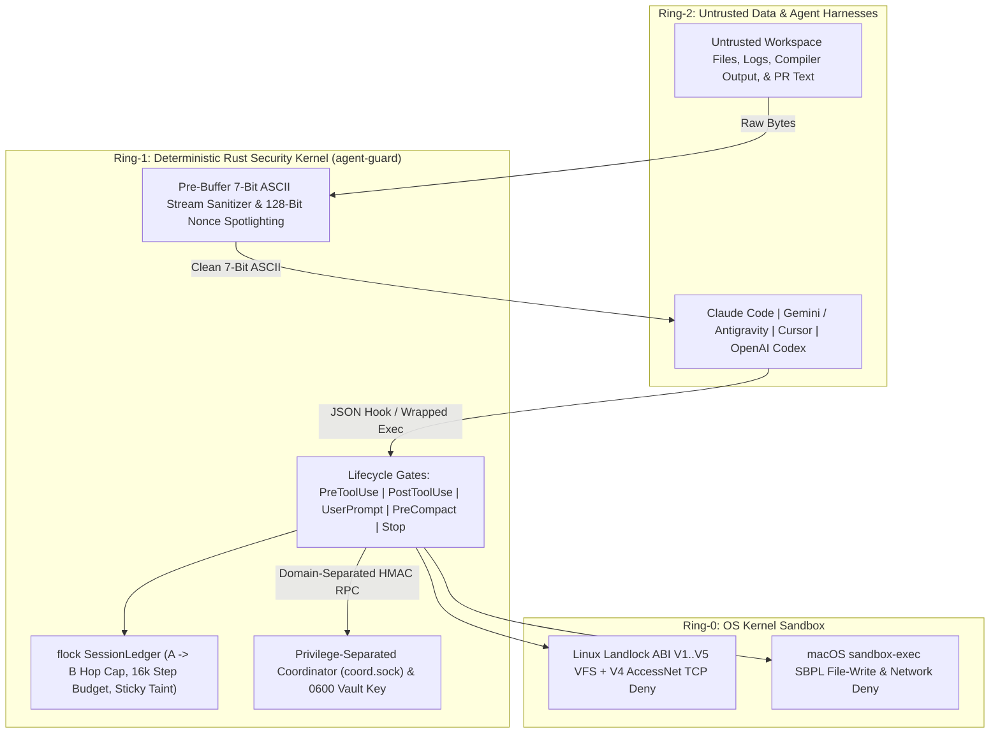

# dotagent

Deterministic zero-trust security kernel, privilege-separated multi-agent swarm runtime, and reproducible harness compiler for Claude Code, Gemini / Antigravity, Cursor, and OpenAI Codex.

`dotagent` enforces repository containment, pre-buffer 7-bit ASCII sanitization, transitive reference hop limits (`A -> B`), Git/build-tool RCE lockdown, and OS-kernel sandboxing (`#![forbid(unsafe_code)]`, zero production `unwrap`/`expect`/`panic`) with sub-`0.4 ms` in-process (`~1.4 ms` cold-CLI) hook latency, `744 MiB/s` stream sanitization, and zero workflow friction.

## Architecture & Trust Rings



## Enforced Security Guarantees

1. **Single Root Authority & 128-Bit Spotlighting**: Only `<repo_root>/AGENTS.md` (depth `0`) holds instruction authority. Nested or shadow instruction files (`CLAUDE.md`, `.cursorrules`, `.windsurfrules`, `.github/copilot-instructions.md`) are blocked at runtime and in static repository audits. Untrusted inputs are quarantined inside per-step 128-bit nonces (`<<<UNTRUSTED_ASCII_DATA_<nonce>>>>`).
2. **Pre-Buffer 7-Bit ASCII Sanitization & RFC 7493 Strict JSON**: Prior to context ingestion, `agent-guard sanitize-stream` strips CR/ANSI/control bytes, neuters non-ASCII (`>= 0x80`), and defangs `\uXXXX`, `\UXXXXXXXX`, `\xXX`, `\033`, `&#...;`, and `%XX` escapes. Trojan Source Bidi controls, Unicode Tags (`U+E0000..U+E007F`), Variation Selectors, homoglyphs, and duplicate JSON object keys (`RFC 7493` I-JSON smuggling) fail closed immediately.
3. **Zero Cache, Temp, Dependency, Secret, or Guard-State Snooping**: Component-by-component `lstat` resolution blocks access and symlinks into `/tmp`, `/var/tmp`, `/dev/shm`, `tmp/`, `.cache/`, `__pycache__/`, `.next/`, `.turbo/`, `node_modules/`, `vendor/`, `.venv/`, `.env*`, `~/.ssh`, `~/.aws`, and `~/.local/state/agent-guard` (`audit.jsonl` self-blindness).
4. **Max Depth-2 Walks & `A -> B` Transitive Reference Ceiling**: Directory walks require explicit depth `<= 2`. Lock-serialized `SessionLedger` provenance permits `File A -> File B` and hard-stops `File B -> File C` across step compactions while tripping a session halt on any cache/temp/dependency pointer.
5. **Git, Build-Tool, & Shell AST Lockdown**: Enforces 19 hardened global Git keys (`core.hooksPath=/dev/null`, `core.attributesFile=/dev/null`, `core.fsmonitor=false`, `protocol.allow=never` + `https` only, `transfer.fsckObjects=true`), audits `.cargo/config*` (`rustc-wrapper`/`linker`/`runner`), `.yarnrc*` (`yarnPath`), and `.github/workflows/*.yml` (zero chained triggers), and validates shell ASTs before execution.
6. **Privilege-Separated Swarm v2 & Kernel Sandboxing**: Six least-privilege Swarm roles (`master`, `investigator`, `qa-engineer`, `grunt`, `adversarial-reviewer`, `forensic-coroner`) operate under scoped capabilities, domain-separated HMAC-SHA256 breadcrumbs (`coord.sock` holds the `0600` vault key outside worker Landlock rulesets), upfront `1 / 0..2 / 0..N` fault triangulation, and fail-closed `2+2` Work Ledger stop gates.

## Measured Release Performance

Reproducible measurements via `./target/release/dotagent-harness bench` (`rustc` release profile, `x86_64-unknown-linux-gnu`):

| Benchmark | Iters | `p50` (`us`) | `p95` (`us`) | `p99` (`us`) | Throughput |
| :--- | ---: | ---: | ---: | ---: | ---: |
| `pre_tool_read_hook_inproc` | 400 | 364 | 448 | 529 | - |
| `pre_tool_bash_ast_inproc` | 400 | 274 | 358 | 395 | - |
| `post_tool_scan_inproc` | 400 | 218 | 289 | 326 | - |
| `sanitize_stream_64k` | 400 | 84 | 95 | 104 | `744.0 MiB/s` |
| `cli_pre_tool_cold_start` (spawn + lock + JSON) | 50 | 1,439 | 1,695 | 1,746 | - |

## 60-Second Zero-Friction Onboarding

Build and install the read-only (`0555`) binaries into `~/.local/bin` and activate `dotagent` globally:

```bash
./scripts/activate-local.sh
dotagent doctor
```

Activate deterministic hooks on any external repository without clobbering existing IDE preferences:

```bash
dotagent activate /path/to/your/repo
```

What `dotagent activate` guarantees:
- **Non-Destructive Backups & JSON Preference Merging**: Snapshots existing `.claude/settings.json`, `.cursor/hooks.json`, `~/.gemini/settings.json`, and `~/.gitconfig` to `.dotagent.bak` before enforcing security keys, preserving unrelated user settings (`theme`, `model`, editor UI flags) and cleanly restoring originals on `dotagent deactivate /path/to/your/repo`.
- **GUI IDE Hook Pinning**: Rewrites hook commands to absolute `~/.local/bin/agent-guard` paths on external workspaces and `~/.gemini/settings.json` so GUI apps (Cursor, Claude Desktop, VS Code) never fail when launched outside an interactive shell `PATH`, while configuring `~/.bashrc` and `~/.zshenv`.
- **Instant Self-Remediation**: Every `[agent-guard HARD DENY :: <CODE>]` diagnostic includes an actionable `Remediation:` line and maps to `dotagent explain <CODE>`.

## Install Channels (prebuilt, attested, no recompilation)

Every channel repackages the same four attested release archives (`x86_64`/`aarch64` x `linux-musl`/`apple-darwin`); nothing is rebuilt. Windows is not supported yet.

| Channel | Command | Trust anchor |
| --- | --- | --- |
| Installer | `curl -fsSL https://susanb.dev/dotagent/install.sh \| bash` | baked SHA-256 + YubiKey PIV P-256 signature on `SHA256SUMS` (`SHA256SUMS.sig`) |
| Homebrew | `brew install susanbdev/tap/dotagent` | pinned SHA-256 in formula + GitHub attestation |
| PyPI / uv | `uv tool install dotagent` (or `pip install dotagent`) | Trusted Publishing + PEP 740 attestations |
| npm | `npm i -g @susanbdev/dotagent` (no install scripts) | Trusted Publishing + npm provenance |
| cargo | `cargo binstall --git https://github.com/susanbdev/dotagent dotagent-compiler agent-guard` | GitHub attestation |
| Linux packages | `.deb` / `.rpm` / `.apk` from the release page (`root:root 0555` `/opt/dotagent`) | GitHub attestation + `SHA256SUMS.sig` |
| macOS | `dotagent-<tag>-universal-apple-darwin.pkg` (Developer ID signed, notarized) | Apple + `SHA256SUMS.macos.sig` |
| OCI | `docker pull ghcr.io/susanbdev/dotagent:<version>` | GitHub attestation |

Installer flags (pass after `bash -s --`): `--activate --workspace DIR`, `--bin-dir DIR` (absolute), `--system` (existing root shell with a root-owned `$HOME` only), `--require-attestation` (needs `gh`; pins repo, signer workflow and `refs/tags/<tag>`). The installer refuses to run inside a guarded agent session, refuses a truncated stream (final `--eof-v1` sentinel), purges every non-installer shell function before doing any work, and rejects hardlinks/links/devices in the archive. It cannot defend against a hostile `BASH_ENV`/`SHELLOPTS`/`PS4` exported into the invoking shell; run it from a clean shell. Verify any asset by hand with `gh attestation verify <file> --owner susanbdev`.

The `.deb`/`.rpm`/`.apk` packages are not individually signed; authenticate them through the YubiKey-signed `SHA256SUMS` or the GitHub attestation before installing (`apk` needs `--allow-untrusted` for that reason). `scripts/activate-local.sh --from-prebuilt DIR` requires `--prebuilt-sums FILE`, a `SHA256SUMS`-style list (`<hex>  bin/<name>`) that the caller must itself have obtained from a verified source.

Release maintainers: `packaging/` holds the repackager, installer template and nfpm/OCI definitions; `scripts/sign-release-yk.sh <tag>` is the YubiKey ceremony (see its header for the required environment). The `release` job gate requires the tag commit to be on `main` and the annotated tag to be GitHub-verified; publishing jobs run in the protected environments `release`, `release-pypi`, `release-npm` and `release-homebrew`.

## Unified `dotagent` Operator CLI

`dotagent` is a single multicall binary providing operator workflows alongside low-level lifecycle hooks:

```bash
dotagent doctor [--json] [repo_root]          # 7-point binary, gitconfig, bundle, kernel, & session check
dotagent explain <CODE | --list> [--json]     # Remediation guide for all 33 typed GuardCode diagnostics
dotagent session-reset <session_id|--all>     # Interactive human-TTY circuit-breaker & taint reset
dotagent activate [target_repo_root]          # Non-destructive workspace & global harness activation
dotagent deactivate [target_repo_root]        # Restore .dotagent.bak configs cleanly
dotagent audit-repo [repo_root]               # Static Git/hook/build-trap/shadow-authority/CI audit
dotagent swarm <role> <subcommand> [...]      # Delegate to swarm-tool (master|investigator|qa|grunt|...)
dotagent compile <build|verify> [repo_root]   # Delegate to dotagent-compiler deterministic bundle engine
dotagent harness <run|list|bench> [...]       # Delegate to dotagent-harness corpus & benchmark runner
```

## Workspace Crates

| Crate | Binary | Purpose |
| :--- | :--- | :--- |
| [`crates/agent-guard`](crates/agent-guard) | `agent-guard`, `dotagent` | Core zero-trust lifecycle kernel, shell/path/Unicode/JSON validators, Landlock/Seatbelt sandbox, privilege-separated HMAC coordinator, and operator CLI |
| [`crates/swarm-tools`](crates/swarm-tools) | `swarm-tool` | Role-scoped deterministic CLI for the 6 Swarm v2 agents (`master`, `investigator`, `qa`, `grunt`, `reviewer`, `coroner`) |
| [`crates/dotagent-compiler`](crates/dotagent-compiler) | `dotagent-compiler` | Reproducible multi-harness bundle compiler, pure-7-bit-ASCII gate, `policy-hub` validator, and `dist-verify/manifest.sha256` verifier |
| [`crates/dotagent-harness`](crates/dotagent-harness) | `dotagent-harness` | Multi-harness replay engine, `305+` adversarial bypass corpus runner, and `p50`/`p95`/`p99` microbenchmark suite |

## Verification & Security Documentation

```bash
cargo fmt --all -- --check
cargo clippy --workspace --all-targets --offline -- -D warnings
cargo test --workspace --offline
./target/release/dotagent-compiler verify .
./target/release/dotagent audit-repo .
./target/release/dotagent-harness bench --quick
```

- Formal architecture, trust rings, key hierarchy, and kernel matrix: [THREAT_MODEL.md](THREAT_MODEL.md)
- Vulnerability reporting and supported versions: [SECURITY.md](SECURITY.md)
- GitHub repository and organization rulesets: [GitHub ruleset setup and drift checks](docs/GITHUB_RULESETS.md)
- Release history: [CHANGELOG.md](CHANGELOG.md)

## License

**Free for personal, educational, and individual non-commercial use.** Commercial and enterprise use requires a paid commercial license -- see [LICENSE](LICENSE) for full terms.

