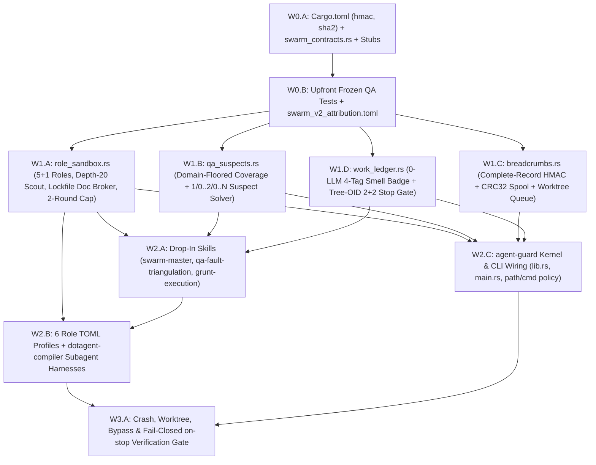

# `susanbdev/dotagent` v2.0 -- Skill-First Swarm & Local Provenance Implementation Plan

- **Plan ID**: `DOTAGENT-PLAN-SWARM-2.0`
- **Target Branch**: `feat/swarm-v2` (stacked cleanly atop `feat/zero-trust-agent-guard` @ `35d23eb`)
- **Governing Spec & ADR**: [`SWARM_TECHNICAL_SPEC.md`](file:///home/antigravity/susanbdev/dotagent/docs/SWARM_TECHNICAL_SPEC.md) + [`ADR-0001-zero-trust-swarm-and-counterfactual-optimization.md`](file:///home/antigravity/susanbdev/dotagent/docs/adr/ADR-0001-zero-trust-swarm-and-counterfactual-optimization.md)
- **Executable Wave Graph**: [`swarm_v2.dag.json`](file:///home/antigravity/susanbdev/dotagent/docs/swarm_v2.dag.json)
- **Hard Constraints**:
  1. `Rust 2024`, `#![forbid(unsafe_code)]`, minimal audited pure-Rust dependencies (`hmac = "0.12"`, `sha2 = "0.10"`).
  2. **Skill-First & Infrastructure-Free**: Zero VM hypervisors, zero encryption daemons, zero external servers--just badass `SKILL.md` packs, multi-harness subagent configs, and fast local `agent-guard` CLI hooks.
  3. **100% pure 7-bit ASCII** (`<= 3 KiB` per `SKILL.md`); preserve `100%` pass rate across existing `277` vectors in [`bypass_corpus.toml`](file:///home/antigravity/susanbdev/dotagent/tests/bypass_corpus.toml).

---

## 1. Post-Compaction Self-Prompt Summary

> **SELF-PROMPT FOR POST-WIPE ORCHESTRATOR**:
> Build `susanbdev/dotagent` v2.0 on branch `feat/swarm-v2` across the `4` waves (`W0 -> W1 -> W2 -> W3`) defined in [`swarm_v2.dag.json`](file:///home/antigravity/susanbdev/dotagent/docs/swarm_v2.dag.json):
> 1. **`W0` (`W0.A -> W0.B`)**: Add `hmac` + `sha2` to `crates/agent-guard/Cargo.toml`, define shared structs in `crates/agent-guard/src/swarm_contracts.rs`, wire stub modules into [`lib.rs`](file:///home/antigravity/susanbdev/dotagent/crates/agent-guard/src/lib.rs) so every wave compiles, and write the **upfront frozen QA tests** + `tests/swarm_v2_attribution.toml` before `W1`.
> 2. **`W1` (`W1.A..D` in parallel)**: Implement the 4 disjoint Rust hook modules (`role_sandbox.rs`, `qa_suspects.rs`, `breadcrumbs.rs`, `work_ledger.rs`).
> 3. **`W2` (`W2.A..C` in parallel)**: Author the 3 drop-in `SKILL.md` packs (`swarm-master`, `qa-fault-triangulation`, `grunt-execution`), compile the 5+1 role profiles & harness subagents via [`main.rs`](file:///home/antigravity/susanbdev/dotagent/crates/dotagent-compiler/src/main.rs), and wire the CLI subcommands into `agent-guard`.
> 4. **`W3` (`W3.A`)**: Run crash-recovery, git-worktree exclude, Reviewer exfiltration-block, and positive/fail-closed `on-stop` verification suites.

---

## 2. Executable Wave Graph (`100%` Synced with `swarm_v2.dag.json`)



---

## 3. Shared Rust Contracts (`W0.A`: `crates/agent-guard/src/swarm_contracts.rs`)

```rust
pub const MAX_ADVERSARIAL_ROUNDS: u8 = 2;

#[derive(Debug, Clone, Copy, PartialEq, Eq)]
pub enum SwarmRole {
    Master,
    Investigator,
    QaEngineer,
    Grunt,
    AdversarialReviewer,
    ForensicCoroner,
    StandardCoding,
}

#[derive(Debug, Clone, PartialEq, Eq)]
pub struct AuthenticatedEvent {
    pub schema_version: u16,
    pub repo_sha256: [u8; 32],
    pub plan_sha256: [u8; 32],
    pub session_id: String,
    pub task_id: String,
    pub seq_no: u64,
    pub prev_event_mac: [u8; 32],
    pub op: EventOp,
    pub canonical_rel_path: String,
    pub line_range: Option<(u64, u64)>,
    pub doc_sha256: [u8; 32],
}

#[derive(Debug, Clone, PartialEq, Eq)]
pub enum SuspectVerdict {
    SuspectIsolated { primary_suspect: String, failing_tests: Vec<String> },
    BlockedByNeighbor { victim: String, neighbor_suspect: String, boundary_test: String },
    SeamOrSpecConflict { task_a: String, task_b: String, boundary_test: String },
    InconclusiveAskMaster { reason: String },
}
```

---

## 4. Detailed Wave Specifications

### Wave 0 -- Shared Contracts & Upfront QA (`W0.A -> W0.B`)
- **`W0.A`**: Add `hmac = "0.12"` and `sha2 = "0.10"` to `crates/agent-guard/Cargo.toml`; create `swarm_contracts.rs` and attach stub modules (`role_sandbox`, `qa_suspects`, `breadcrumbs`, `work_ledger`) in `lib.rs` so `cargo clippy --workspace --all-targets -- -D warnings` type-checks all new files at every step.
- **`W0.B`**: Author upfront spec tests in `crates/agent-guard/tests/swarm_v2_contracts.rs` and `tests/swarm_v2_attribution.toml` before `W1` starts.

### Wave 1 -- 4 Parallel Lightweight Rust Hook Modules
- **`W1.A` (`crates/agent-guard/src/role_sandbox.rs`)**:
  - `Master`: blocks source `Read`/`Edit`/`Write`/`Grep`; validates the 4 human-escalation triggers and typed worker outputs (`ObservedFact`, `WorkerHypothesis`, `PlanAmendmentProposal`).
  - `Investigator`: `0` writes; permits `20+` depth directory search while keeping `realpath`-canonicalized forbidden zones (`/tmp`, caches, `node_modules`, `.venv`, `.env*`, guard state) hard-blocked (`exit 2`).
  - `QaEngineer`: writes restricted strictly to test files and `test_attribution.toml`.
  - `Grunt`: `0` search (`rg`/`find` blocked); reads restricted to `assigned_read_paths`; writes restricted to `allowed_write_paths`.
  - `AdversarialReviewer`: `0` writes; offline default + lockfile-verified `lookup_doc` package ID check (**zero arbitrary URLs**); hard `MAX_ADVERSARIAL_ROUNDS = 2` escalation gate.
- **`W1.B` (`crates/agent-guard/src/qa_suspects.rs`)**:
  - Validates `PLAN.dag.json` acyclicity + parallel write-set disjointness; computes `max(domain_floor, dag_fanout)` coverage targets (`50%..95%`); cross-checks `test_attribution.toml` against DAG paths; computes `SuspectVerdict`.
- **`W1.C` (`crates/agent-guard/src/breadcrumbs.rs`)**:
  - Mints task-bound `session_id`s; computes length-delimited `HMAC-SHA256` over `AuthenticatedEvent` (binding `canonical_rel_path`, `line_range`, `task_id`, `doc_sha256`); writes `[u32 len][u32 crc32][json]\n` spools and flushes idempotently (`event_id` dedup + `flock` + `fsync` + `git rev-parse --git-path info/exclude`) to `<dir>/.breadcrumbs.jsonl`.
- **`W1.D` (`crates/agent-guard/src/work_ledger.rs`)**:
  - `0`-LLM 4-bucket heuristic tagger (`MALICIOUS`, `OFF_TASK`, `CONFUSED`, `RISKY` including blob-hash `edit_after_last_green_test`, `compile_loop`, `test_deleted`) + `2+2` pure-ASCII sentence `WORK_LEDGER.jsonl` validator bound to `(session_id, attempt_id, git_tree_oid)` + fail-closed `on-stop` check.

### Wave 2 -- Flagship Skills, Compiled Role Harnesses & CLI Subcommands
- **`W2.A` (`skills/{swarm-master,qa-fault-triangulation,grunt-execution}/SKILL.md`)**:
  - Pure 7-bit ASCII (`<= 3 KiB` each) operational skills encoding the complete `Master` interrogation/wipe/escalation playbook, `QA` upfront boundary/attribution playbook, and `Grunt` `7B`-discipline + `2+2` Work Ledger playbook.
- **`W2.B` (`profiles/*.toml`, `crates/dotagent-compiler/src/main.rs`, `skills/manifest.lock.json`, `dist/**`, `dist-verify/manifest.sha256`)**:
  - Compiles all 5+1 role profiles and subagent definitions across Claude Code (`.claude/agents/{master,investigator,qa-engineer,grunt,adversarial-reviewer,forensic-coroner}.md`), Codex, Cursor, and Gemini.
- **`W2.C` (`crates/agent-guard/src/{lib.rs, main.rs, path_policy.rs, cmd_policy.rs}`)**:
  - Protects `.breadcrumbs.jsonl`, `PLAN.lock*`, and `WORK_LEDGER.jsonl` in `path_policy.rs`; rejects staged `.breadcrumbs.jsonl` on `on-stop`; adds CLI commands (`session-mint`, `exec-tap`, `plan-lock`, `qa-suspects`, `ledger-submit`, `lookup-doc`, `flight-triage`, `trail`).

### Wave 3 -- Adversarial & Crash-Consistency Verification Gate (`W3.A`)
- **`W3.A` (`crates/agent-guard/tests/swarm_v2_adversarial.rs`, `tests/bypass_corpus.toml`)**:
  - Verifies torn-tail spool crash recovery, linked `git worktree` exclude handling, `Investigator` depth-20 allow vs. depth-10 `node_modules` hard deny, `https://docs.rs/<secret>` exfiltration block, path-swap `HMAC` rejection, and both positive (`exit 0`) and fail-closed missing-ledger (`exit 2`) `on-stop` fixtures.

---

## 5. Final Acceptance Gate Checklist

```bash
cargo fmt --all -- --check
cargo clippy --workspace --all-targets -- -D warnings
cargo test --workspace
cargo run -p dotagent-compiler -- build .
cargo run -p dotagent-compiler -- verify .
cargo run -p agent-guard -- on-stop --mode repo-audit <<< '{}'
! AGENT_GUARD_ROLE=grunt AGENT_GUARD_SESSION_ID=ag_uncompleted_test cargo run -p agent-guard -- on-stop <<< '{}'
```
