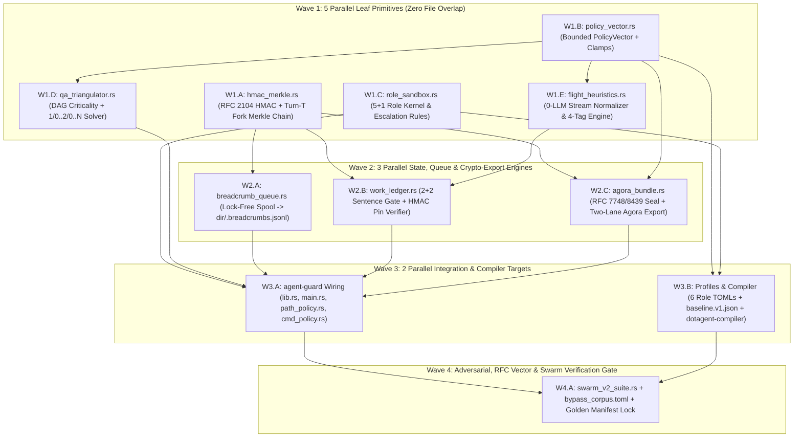

# `susanbdev/dotagent` v2.0 -- Deep Implementation Plan (`PLAN.lock` Ready)

- **Plan ID**: `DOTAGENT-PLAN-SWARM-V2`
- **Target Branch**: `feat/swarm-v2` (stacked cleanly atop `feat/zero-trust-agent-guard` @ `35d23eb`)
- **Governing Spec & ADR**: [`SWARM_TECHNICAL_SPEC.md`](file:///home/antigravity/susanbdev/dotagent/docs/SWARM_TECHNICAL_SPEC.md) + [`ADR-0001-zero-trust-swarm-and-counterfactual-optimization.md`](file:///home/antigravity/susanbdev/dotagent/docs/adr/ADR-0001-zero-trust-swarm-and-counterfactual-optimization.md)
- **Machine-Readable Wave DAG**: [`swarm_v2.dag.json`](file:///home/antigravity/susanbdev/dotagent/docs/swarm_v2.dag.json)
- **Hard Workspace Constraints**:
  1. `Rust 2024`, `#![forbid(unsafe_code)]`, **zero external Cargo dependencies** (`std` only across `crates/agent-guard` and `crates/dotagent-compiler`).
  2. **100% pure 7-bit ASCII** (`0x09`, `0x0A`, `0x20..0x7E`) across all source, TOML, JSON, skill, and Markdown files (verified by `dotagent-compiler verify .`).
  3. Preserve `100%` pass rate across all `277` existing vectors in [`bypass_corpus.toml`](file:///home/antigravity/susanbdev/dotagent/tests/bypass_corpus.toml) and [`adversarial_suite.rs`](file:///home/antigravity/susanbdev/dotagent/crates/agent-guard/tests/adversarial_suite.rs).

---

## 1. Post-Compaction Self-Prompt Executive Summary (Read Only This + `swarm_v2.dag.json` After Wipe)

> **SELF-PROMPT FOR POST-WIPE ORCHESTRATOR**:
> You are implementing `susanbdev/dotagent` v2.0 on branch `feat/swarm-v2`. PR #1 (`feat/zero-trust-agent-guard` @ `35d23eb`) already provides the v1.0 Zero-Trust kernel in [`lib.rs`](file:///home/antigravity/susanbdev/dotagent/crates/agent-guard/src/lib.rs) (`sha256.rs`, `json.rs`, `sanitizer.rs`, `unicode_guard.rs`, `injection_scan.rs`, `path_policy.rs`, `cmd_policy.rs`, `budget_guard.rs`, `traversal_ledger.rs`) and [`main.rs`](file:///home/antigravity/susanbdev/dotagent/crates/dotagent-compiler/src/main.rs).
>
> Your objective is to build the **Privilege-Separated 5-Role Swarm + Fork-Safe `HMAC-SHA256` Merkle Provenance + Single-Writer `.breadcrumbs.jsonl` Queue + QA 3-Tier Fault Triangulator + Bounded `PolicyVector` + Two-Lane Encrypted `Agora` Bundler** across **4 strictly ordered topological waves (`W1 -> W2 -> W3 -> W4`)** defined in [`swarm_v2.dag.json`](file:///home/antigravity/susanbdev/dotagent/docs/swarm_v2.dag.json).
>
> **Critical Invariants**:
> 1. Never add external crates to `Cargo.toml`; build `HMAC-SHA256` (RFC 2104), `ChaCha20-Poly1305` (RFC 8439), and `X25519` (RFC 7748) in pure `#![forbid(unsafe_code)]` Rust atop [`sha256.rs`](file:///home/antigravity/susanbdev/dotagent/crates/agent-guard/src/sha256.rs), plus optional `gpg --batch --encrypt` RFC 9580 OpenPGP armor export.
> 2. Never expose hard security rules (forbidden zones, 7-bit ASCII neutering, root `AGENTS.md` authority, command AST denials, MCP endpoint lock) to `PolicyVector`; `PolicyVector` tunes only bounded routing, QA coverage, retry/churn kill-switches, review caps, and triage alert weights.
> 3. Parallel nodes within each wave (`W1.A..E`, `W2.A..C`, `W3.A..B`) have **strictly disjoint `allowed_write_paths`**--do not wire `pub mod` exports in `lib.rs` until barrier wave `W3.A`.
> 4. Every wave must compile cleanly under `cargo clippy --workspace --all-targets -- -D warnings`, and completion requires `cargo fmt --all -- --check`, `cargo test --workspace`, `dotagent-compiler build . && dotagent-compiler verify .`, and `agent-guard on-stop`.

---

## 2. Topological Wave Graph & Parallel Execution Map



> [!NOTE]
> Inside Wave 1, `W1.A`, `W1.B`, and `W1.C` have zero internal prerequisites; `W1.D` and `W1.E` take pure struct inputs (`PolicyKnobs` passed by value) so all five files in Wave 1 can be authored concurrently without touching shared files.

---

## 3. Detailed Node Specifications (7B-Grunt Precision Level)

### Wave 1 -- Core Pure-Rust Primitives

#### Node `W1.A`: Fork-Safe `HMAC-SHA256` Merkle Chain
- **Allowed Write Path**: `crates/agent-guard/src/hmac_merkle.rs`
- **Criticality**: `10/10` (`>= 95%` branch/vector test coverage; foundational crypto primitive)
- **Exact Responsibilities & Public API**:
  1. `pub fn hmac_sha256(key: &[u8], data: &[u8]) -> [u8; 32]` + `pub fn ct_eq_bytes(a: &[u8], b: &[u8]) -> bool` (constant-time comparison, RFC 2104 / RFC 4231 compliant atop `crate::sha256::sha256_bytes`).
  2. `pub fn load_or_init_guard_key(state_dir: &Path) -> Result<[u8; 32], String>`: Creates `hmac.key` with `0600` permissions on Unix using `/dev/urandom` mixed with `boot_id`, PID, and monotonic nanoseconds.
  3. `pub struct ForkCoordinates`: `{ pub cohort_id: String, pub fork_epoch: u32, pub clone_id: u32, pub parent_merkle_root: String, pub model_id: String, pub policy_sha256: String }` loaded from `AGENT_GUARD_*` env vars.
  4. `pub struct SessionIdentity`: Mints deterministic `ag_<repo6>_<cohort6>_c<clone3>_<wave>_<task>_<role>_<rand8>` IDs.
  5. `pub struct MerkleEventRecord` & `pub fn compute_event_hmac(...) -> String`: Computes `ev_<64_hex>` binding `(prev_event_id, fork_epoch, clone_id, session_id, seq_no, ts_ns, op_code, doc_sha256)`. Emits `FORK_BRANCH` genesis event when `fork_epoch > 0` and `seq_no` advances past snapshot turn.
  6. `pub fn verify_event_chain(key: &[u8], events: &[MerkleEventRecord]) -> Result<String, String>`: Validates unbroken hash chain and returns `leaf_merkle_root`.

#### Node `W1.B`: Bounded `PolicyVector` Nudge Engine
- **Allowed Write Path**: `crates/agent-guard/src/policy_vector.rs`
- **Criticality**: `9/10` (`>= 90%` coverage)
- **Exact Responsibilities & Public API**:
  1. `pub struct PolicyVector` (`schema = "dotagent.policy_vector.v1"`):
     - `qa`: `{ base_coverage_floor: f64, fanout_weight: f64, cascade_weight: f64, spine_coverage_cap: f64 }`
     - `routing`: `{ grunt_7b_max_files: usize, min_spec_tokens_per_target: usize, local_to_frontier_cutoff: f64 }`
     - `spin_kill`: `{ max_consecutive_compile_fails: usize, max_churn_ratio: f64, max_enoent_streak: usize }`
     - `review`: `{ max_adversarial_rounds: usize, reviewer_cluster_max_tasks: usize }`
     - `triage`: `{ dir_scatter_alert_count: usize, retry_alert_weight: f64 }`
  2. `pub fn clamp_to_hard_bounds(&self) -> (PolicyVector, Vec<String>)`: Enforces hard Rust min/max clamps (Section 6.2 of Spec) and records clamp advisories so poisoned weights can never disable checks.
  3. `pub fn canonical_json(&self) -> String` & `pub fn sha256_hex(&self) -> String` using fixed-precision formatting so hashes match deterministically across platforms.

#### Node `W1.C`: 5+1 Role Sandbox & Escalation Gate
- **Allowed Write Path**: `crates/agent-guard/src/role_sandbox.rs`
- **Criticality**: `10/10` (`>= 95%` coverage; privilege boundary kernel)
- **Exact Responsibilities & Public API**:
  1. `pub enum SwarmRole`: `Master`, `Investigator`, `QaEngineer`, `Grunt`, `AdversarialReviewer`, `ForensicCoroner`, `StandardCoding`.
  2. `pub struct RoleSandbox`: Parsed from environment (`AGENT_GUARD_ROLE`, `AGENT_GUARD_ALLOWED_WRITE_PATHS`, `AGENT_GUARD_ASSIGNED_READ_PATHS`, `AGENT_GUARD_REVIEW_ROUND`, `AGENT_GUARD_MAX_REVIEW_ROUNDS`).
  3. `pub fn check_tool_and_path_access(&self, tool: &str, rel_path: Option<&str>, is_write: bool) -> Result<(), String>`:
     - `Master`: Blocks all source `Read`/`Edit`/`Write`/`Grep`; permits only `AGENTS.md`, `PLAN.lock*`, `WORK_LEDGER*`, and `docs/*plan*`.
     - `Investigator`: Blocks all `is_write == true`; sets `allow_unbounded_walk_depth() == true` (`20+` levels) while deferring forbidden-zone checks to `path_policy`.
     - `QaEngineer`: Blocks writes unless path matches `tests/*`, `*_test.*`, `*.test.*`, `*.spec.*`, or `test_attribution.toml`.
     - `Grunt`: Blocks `Grep`/`Glob` exploration; blocks reads outside `assigned_read_paths`; blocks writes outside `allowed_write_paths`.
     - `AdversarialReviewer`: Blocks all repo writes; enforces `review_round <= max_adversarial_rounds` (returning `ESCALATE_TO_MASTER_ROUND_LIMIT` on Round `> 2`).
     - `ForensicCoroner`: Blocks all repo reads/writes except `flight-triage` queries.
  4. `pub fn validate_reviewer_url(url: &str) -> Result<(), String>`: Enforces `https://` `GET`-only domain allowlist (`docs.rs`, `crates.io`, `developer.mozilla.org`, `datatracker.ietf.org`, `nvd.nist.gov`, `github.com/advisories`) with query string `<= 256` ASCII chars and zero credentials/fragments.
  5. `pub enum MasterEscalationReason`: `UnbreakableSpinLoop`, `UnforeseenArchitecturalConstraint`, `CriticalAccessBlocked`, `VerifiedHostileInjection` -- validates human escalation payloads.

#### Node `W1.D`: DAG Validator, Criticality Scorer & 3-Tier QA Fault Triangulator
- **Allowed Write Path**: `crates/agent-guard/src/qa_triangulator.rs`
- **Criticality**: `9/10` (`>= 90%` coverage)
- **Exact Responsibilities & Public API**:
  1. `pub struct DagTaskNode { pub id: String, pub wave: String, pub depends_on: Vec<String>, pub allowed_write_paths: Vec<String>, pub cascade_sensitivity: f64 }`
  2. `pub fn validate_plan_dag(nodes: &[DagTaskNode]) -> Result<BTreeMap<String, TaskCriticality>, String>`:
     - Rejects cycles (Kahn's algorithm) and missing dependency IDs.
     - Rejects overlapping `allowed_write_paths` between any two tasks that can execute concurrently (neither depends transitively on the other).
     - Computes transitive downstream count $|\text{Downstream}(T)|$, Importance $I(T) \in [1..10]$, and required coverage floor $C_{\min}(T)$.
  3. `pub struct TestAttribution { pub test_id: String, pub primary: String, pub secondary: Vec<String>, pub tertiary: Vec<String> }`: Enforces `primary` non-empty (`1` task) and `secondary.len() <= 2`.
  4. `pub enum FaultVerdict`:
     - `ConvictTask { culprit: String, failing_tests: Vec<String> }`
     - `CleanBlockedByNeighbor { blocked_task: String, culprit_task: String, boundary_test: String }`
     - `EscalateApproachClashToMaster { task_a: String, task_b: String, boundary_test: String }`
     - `RootFoundationCascade { root_culprit: String, affected_downstream: Vec<String> }`
  5. `pub fn triangulate_failures(attributions: &[TestAttribution], results: &BTreeMap<String, bool>) -> Vec<FaultVerdict>`.

#### Node `W1.E`: Zero-LLM Stream Normalizer & 4-Bucket Heuristic Tagger
- **Allowed Write Path**: `crates/agent-guard/src/flight_heuristics.rs`
- **Criticality**: `8/10` (`>= 85%` coverage)
- **Exact Responsibilities & Public API**:
  1. `pub enum EventOp`: `StdinLine`, `StdoutLine`, `StderrLine`, `FileRead`, `FileWrite`, `FileDelete`, `GrepHit`, `CmdExec`, `TestResult`, `CompilerErr`, `GuardDeny`, `ForkBranch`.
  2. `pub enum HeuristicBucket`: `Malicious`, `OffTask`, `Confused`, `Risky`.
  3. `pub struct FlightAnalyzer`: Streaming state machine ingesting events + final `git diff` hunks, computing:
     - `Malicious`: sanitizer escape/non-ASCII strip count, injection scan matches, `GuardDeny` count.
     - `OffTask`: out-of-scope path attempts, distinct top-level directory scatter `>= dir_scatter_alert_count`.
     - `Confused`: consecutive identical compiler/test error signatures `>= max_consecutive_compile_fails`, `churn_ratio > max_churn_ratio`, consecutive `ENOENT` streak `>= max_enoent_streak`, `should_early_kill: bool`.
     - `Risky`: `edit_after_last_green_test: bool` (`last_write_seq > last_passing_test_seq`), diff removes `#[test]`/`assert`/`expect(` or adds `#[ignore]`/`.skip`, diff adds `#[allow(`/ `unsafe` / `@ts-ignore` / `eslint-disable`.
  4. `pub fn render_tier0_badge(&self) -> String` (`<= 120` ASCII chars) & `pub fn extract_tier1_spans(&self, filter: &[HeuristicBucket], max_tokens: usize) -> String`.

---

### Wave 2 -- Persistence, Single-Writer Queue & `Agora` Crypto Bundler

#### Node `W2.A`: Lock-Free Spool & Single-Writer `.breadcrumbs.jsonl` Engine
- **Allowed Write Path**: `crates/agent-guard/src/breadcrumb_queue.rs`
- **Depends On**: `W1.A`
- **Criticality**: `9/10` (`>= 90%` coverage)
- **Exact Responsibilities & Public API**:
  1. `pub struct BreadcrumbEntry`: Matches Section 8.1 of Spec (`ts_ns`, `cohort_id`, `fork_epoch`, `clone_id`, `session_id`, `role`, `model_id`, `event_id`, `op`, `file`, `lines`, `doc_sha256`).
  2. `pub fn enqueue_session_breadcrumb(spool_root: &Path, entry: &BreadcrumbEntry) -> Result<(), String>`: Lock-free append to exclusive `~/.local/state/agent-guard/spools/<repo_hash>/<session_id>.jsonl` (`0600`).
  3. `pub fn flush_breadcrumb_queue(repo_root: &Path, spool_root: &Path) -> Result<usize, String>`:
     - Ensures `.breadcrumbs.jsonl` is present in `<repo_root>/.git/info/exclude` (never tracked by git).
     - Acquires single-writer queue lock (`~/.local/state/agent-guard/locks/<repo_hash>.queue.lock`), reads unread spool offsets, collapses contiguous `GREP` line hits per `(session_id, file, doc_sha256)`, and writes sequentially into each touched `<dir>/.breadcrumbs.jsonl`.
  4. `pub fn query_breadcrumbs(repo_root: &Path, filter_file: Option<&str>, filter_session: Option<&str>) -> Result<Vec<BreadcrumbEntry>, String>`.
  5. `pub fn harvest_all_repo_breadcrumbs(repo_root: &Path) -> Result<BTreeMap<String, Vec<BreadcrumbEntry>>, String>`: Collects all `.breadcrumbs.jsonl` across touched directories for `Agora` telemetry bundling.

#### Node `W2.B`: Verified `2+2` Sentence Work Ledger & `on-stop` Completion Gate
- **Allowed Write Path**: `crates/agent-guard/src/work_ledger.rs`
- **Depends On**: `W1.A`, `W1.E`
- **Criticality**: `9/10` (`>= 90%` coverage)
- **Exact Responsibilities & Public API**:
  1. `pub enum ContractStatus`: `Exact`, `LocalWorkaround`, `InterfaceChanged`.
  2. `pub fn validate_and_append_work_ledger(...) -> Result<WorkLedgerEntry, String>`:
     - Verifies `actions_summary` has `1..=2` sentences (`<= 60` words) and `issues_and_mitigations` has `1..=2` sentences (`<= 60` words), pure 7-bit ASCII, zero injection triggers.
     - Verifies `pinned_event_ids` is non-empty and **every ID exists in `session_id`'s verified `MerkleEventRecord` log** (`O(1)` lookup).
     - Verifies on-disk `SHA-256` of modified files matches the latest `FileWrite` receipt in `pinned_event_ids` and `edit_after_last_green_test == false` for `Grunt` / `QaEngineer`.
     - Computes `RustGroundTruth` (`actual_files_touched`, `scope_violation`, `post_test_edit`, `churn_ratio`, `heuristic_badge`) and appends atomically to `WORK_LEDGER.jsonl`.
  3. `pub fn verify_session_completed_ledger(ledger_path: &Path, session_id: &str) -> Result<(), String>`: Called by `on-stop` for subagent roles (`Investigator`, `QaEngineer`, `Grunt`, `AdversarialReviewer`, `ForensicCoroner`); returns `HARD DENY` if missing.

#### Node `W2.C`: Zero-Dependency Public-Key Envelope & Two-Lane `Agora` Exporter
- **Allowed Write Path**: `crates/agent-guard/src/agora_bundle.rs`
- **Depends On**: `W1.A`, `W1.B`
- **Criticality**: `10/10` (`>= 95%` coverage + official IETF RFC vectors)
- **Exact Responsibilities & Public API**:
  1. Pure-Rust `#![forbid(unsafe_code)]` RFC 7748 `x25519(scalar: [u8; 32], point: [u8; 32]) -> [u8; 32]` + RFC 8439 `chacha20_poly1305_seal(...)` / `open(...)` (for unit-test verification; worker VMs only ever hold `agora_recipient_pubkey: [u8; 32]` in production!).
  2. Optional RFC 9580 OpenPGP external armor mode (`seal_with_gpg_recipient`) when `AGENT_GUARD_PGP_RECIPIENT_FILE` is set, wrapping the attested manifest bundle.
  3. `pub fn build_hot_scorecard(...) -> AgoraScorecard`: `< 2 KiB` JSON frame (Section 8.3 of Spec) + `shard_id(cohort_id, num_shards)` consistent hashing + `HMAC` attestation tag.
  4. `pub fn pack_and_seal_delta_bundle(...) -> Result<SealedAgoraBundle, String>`:
     - Filters session Merkle logs strictly to `seq_no > fork_turn` (`Turn 231..End` delta only) anchored to `parent_merkle_root`.
     - Bundles delta events + harvested `.breadcrumbs.jsonl` + `WORK_LEDGER.jsonl` + `PolicyVector` + `manifest.sha256`.
     - Encrypts with ephemeral `X25519` keypair against `Agora` public key (`HKDF-SHA256` -> `ChaCha20-Poly1305`), zeroizes ephemeral scalar on stack, and computes deterministic upload jitter `clone_id * 20` ms.
  5. `pub fn compute_cohort_grpo_advantages(scorecards: &[AgoraScorecard], union_test_pass: &BTreeMap<u32, f64>) -> BTreeMap<u32, f64>`: Computes group-relative advantage $A_i = (R_i - \mu_c) / (\sigma_c + 10^{-8})$ across all `N` clones.

---

### Wave 3 -- Kernel Integration, CLI Subcommands & Multi-Harness Compiler

#### Node `W3.A`: `agent-guard` Kernel & CLI Wiring
- **Allowed Write Paths**: `crates/agent-guard/src/lib.rs`, `crates/agent-guard/src/main.rs`, `crates/agent-guard/src/path_policy.rs`, `crates/agent-guard/src/cmd_policy.rs`
- **Depends On**: `W1.A..E`, `W2.A..C`
- **Exact Changes**:
  1. [`path_policy.rs`](file:///home/antigravity/susanbdev/dotagent/crates/agent-guard/src/path_policy.rs): Hard-block agent writes/deletes to `.breadcrumbs.jsonl`, `PLAN.lock.md`, `PLAN.dag.json`, and direct edits to `WORK_LEDGER.jsonl`.
  2. [`cmd_policy.rs`](file:///home/antigravity/susanbdev/dotagent/crates/agent-guard/src/cmd_policy.rs):
     - Block any shell mutation/unset of `AGENT_GUARD_*` env vars.
     - Relax `max_directory_walk_depth` solely when `SwarmRole::Investigator` is active (while preserving all forbidden-zone AST checks).
     - Block `rg`/`grep`/`find` shell invocations when `SwarmRole::Grunt` or `SwarmRole::Master` is active.
     - Permit `curl --proto =https -sS` `GET`-only against `validate_reviewer_url` domains solely when `SwarmRole::AdversarialReviewer` is active.
  3. [`lib.rs`](file:///home/antigravity/susanbdev/dotagent/crates/agent-guard/src/lib.rs): Integrate `RoleSandbox`, `MerkleEventRecord` receipt emission (`[ag:receipt id=ev_... sha256=...]`), `breadcrumb_queue` spooling + auto-flush on `PreTool`/`PostTool`/`PostEdit`, and `work_ledger` completion check on `on-stop`.
  4. [`main.rs`](file:///home/antigravity/susanbdev/dotagent/crates/agent-guard/src/main.rs): Add subcommands:
     - `session-mint --wave <W> --task <T> --role <R>`
     - `exec-tap -- <cmd> [args...]` (captures `stdin`/`stdout`/`stderr` line-by-line into Merkle flight log + breadcrumb queue)
     - `plan-lock <plan_md> <dag_json>` (validates DAG & disjoint write-sets, `chmod 0444`, stores `SHA-256`)
     - `qa-triangulate <dag_json> <attribution_toml> <results_json>`
     - `ledger-submit --actions "..." --issues "..." --status <EXACT|...> --pins ev_1,ev_2`
     - `flight-triage <session_id> [--buckets MALICIOUS,OFF_TASK,CONFUSED,RISKY]`
     - `trail [--file <p>] [--session <sid>]`
     - `agora-seal --pubkey <hex> --out-dir <dir>`

#### Node `W3.B`: Swarm Role Profiles, Baseline `PolicyVector` & `dotagent-compiler`
- **Allowed Write Paths**:
  - `profiles/master-orchestrator.toml`
  - `profiles/zero-trust-investigator.toml`
  - `profiles/qa-engineer.toml`
  - `profiles/standard-grunt.toml`
  - `profiles/adversarial-reviewer.toml`
  - `profiles/forensic-coroner.toml`
  - `profiles/weights/baseline.v1.json`
  - `crates/dotagent-compiler/src/main.rs`
  - `dist/**` and `dist-verify/manifest.sha256` (regenerated via `dotagent-compiler build .`)
- **Depends On**: `W1.B`, `W1.C`
- **Exact Changes**:
  1. Create all 6 role TOMLs + `profiles/weights/baseline.v1.json` with pure 7-bit ASCII schemas.
  2. Extend [`crates/dotagent-compiler/src/main.rs`](file:///home/antigravity/susanbdev/dotagent/crates/dotagent-compiler/src/main.rs) to validate all swarm profiles + `PolicyVector` bounds, compile subagent harness definitions (`dist/claude/agents/{master,investigator,qa-engineer,grunt,adversarial-reviewer,forensic-coroner}.md` + `dist/policy/baseline.v1.json`), and pin `SHA-256` digests in `dist-verify/manifest.sha256`.

---

### Wave 4 -- Adversarial, Crypto-Vector & Swarm Verification Gate

#### Node `W4.A`: Comprehensive Test Matrix & Corpus Expansion
- **Allowed Write Paths**: `crates/agent-guard/tests/swarm_v2_suite.rs`, `tests/bypass_corpus.toml`
- **Depends On**: `W3.A`, `W3.B`
- **QA 3-Tier Test Attribution Matrix (Dogfooded)**:

| Test Suite Group | `Primary (1)` | `Secondary (0..2)` | `Tertiary` | Required Verification |
| :--- | :--- | :--- | :--- | :--- |
| `rfc4231_hmac_and_turn230_fork_x100` | `W1.A` | `[]` | `[]` | Official RFC 4231 HMAC vectors + `100` simulated post-Turn-230 clones proving `0` ID collisions and shared `E_230` ancestry. |
| `policy_vector_bounds_and_canonical_hash` | `W1.B` | `["W3.B"]` | `[]` | Out-of-bounds weight clamping + deterministic cross-load `SHA-256`. |
| `role_privilege_matrix_and_reviewer_net` | `W1.C` | `["W3.A"]` | `[]` | `Master` source-read deny; `Investigator` 20-level deep grep allow + `node_modules` depth-12 hard deny; `Grunt` `rg` & out-of-scope write deny; `QaEngineer` prod-code write deny; `Reviewer` Round-3 escalation & URL exfil block. |
| `dag_disjoint_waves_and_qa_sbfl_solver` | `W1.D` | `["W1.B"]` | `[]` | Cycle rejection, parallel write-path overlap rejection, all 4 `FaultVerdict` truth-table cases (`Primary`, `CleanBlockedByNeighbor`, `EscalateApproachClashToMaster`, `RootFoundationCascade`). |
| `flight_stream_4bucket_heuristics` | `W1.E` | `["W1.B"]` | `[]` | `compile_loop`, `churn_ratio`, `edit_after_last_green_test`, deleted `#[test]`, added `#[allow]`/`unsafe`, Tier-0 badge & Tier-1 span cap. |
| `single_writer_breadcrumbs_and_git_exclude` | `W2.A` | `["W1.A", "W3.A"]` | `[]` | Concurrent multi-session spooling -> ordered `.breadcrumbs.jsonl`, `.git/info/exclude` injection, direct LLM edit block. |
| `work_ledger_stop_gate_and_forged_pins` | `W2.B` | `["W1.A", "W1.E"]` | `["W3.A"]` | Rejects `>2` sentences, non-ASCII, fabricated HMAC ID, cross-session HMAC ID, post-test dirty file hash, and missing ledger on `on-stop`. |
| `rfc7748_8439_crypto_and_agora_delta_grpo` | `W2.C` | `["W1.A", "W1.B"]` | `[]` | Official RFC 7748 `X25519` + RFC 8439 `ChaCha20-Poly1305` vectors, `< 2 KiB` scorecard cap, `Turn 231..End` delta-only packing, `GRPO` cohort advantage math. |

---

## 4. Final Acceptance Gate Checklist

Execution is complete **only** when all five commands exit `0` with zero warnings:

```bash
cargo fmt --all -- --check
cargo clippy --workspace --all-targets -- -D warnings
cargo test --workspace
cargo run -p dotagent-compiler -- verify .
cargo run -p agent-guard -- on-stop <<< '{}'
```
