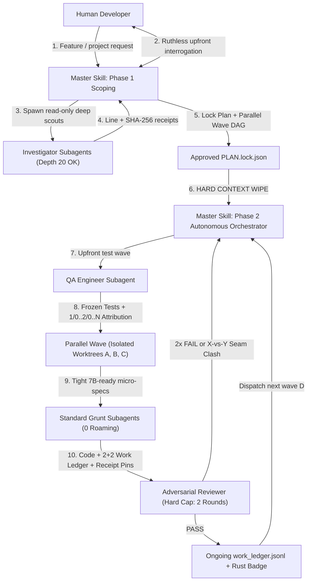

# `susanbdev/dotagent` -- Multi-Role Swarm Skills, Subagent Harnesses & Local Provenance Specification (v2.0)

- **Document ID**: `DOTAGENT-SPEC-SWARM-2.0`
- **Status**: Canonical Baseline Agent Specification
- **Repository**: `susanbdev/dotagent`
- **Deliverables**: 6 Role Skill Packs (`skills/swarm-*/{SKILL.md, ROLE_GUIDE.md}`) + Dedicated Rust Role CLI (`crates/swarm-tools` `swarm-tool`) + Multi-Harness Subagent Configs (`.claude/`, `.codex/`, `.cursor/`, `gemini`) + Lightweight [`agent-guard`](file:///home/antigravity/susanbdev/dotagent/crates/agent-guard/src/lib.rs) Hooks
- **Subordinate To**: Root [`AGENTS.md`](file:///home/antigravity/susanbdev/dotagent/AGENTS.md) (`RING-1`) and [`spec.md`](file:///home/antigravity/susanbdev/dotagent/spec.md)

---

## 1. Mission & Right-Sized Scope ("How Coding Agents Should Actually Work")

Standard coding agent setups dump exploration, planning, implementation, testing, and code review into one long-lived `100k-200k` context window. Over multi-step features, context fills with search noise, lossy compaction drops constraints, untrusted code comments sit in the same prompt buffer as orchestration authority, and subagents routinely claim "tests pass" after making untested last-second edits.

`susanbdev/dotagent` v2 solves this **entirely as a portable baseline of 6 Role Skill Packs (each with `SKILL.md` + explicit `ROLE_GUIDE.md` manual), Dedicated Rust Role Tooling (`swarm-tool`), Subagent Definitions, and fast local `agent-guard` CLI hooks** that work out of the box on any repository or workstation--requiring zero external servers, zero custom VMs, and zero cloud lock-in.

> [!IMPORTANT]
> **Clear Boundary (Skills & Hook Guard vs. Outer VM Platforms)**:
> - **`susanbdev/dotagent` (This Repo)**: Enforces **LLM-layer discipline**--role privilege separation, ruthless upfront planning, context hygiene, prompt-injection sanitization, upfront QA fault attribution, local Hansel & Gretel `.breadcrumbs.jsonl` trails, `0`-LLM Rust smell badges, and mandatory `2+2`-sentence Work Ledgers. All runtime logs emit clean local JSONL files on disk.
> - **Outer Execution Platforms (Separate Projects)**: OS-level container/microVM containment, multi-VM snapshot branching, and external fleet telemetry ingestion live outside `dotagent` and can optionally consume `dotagent`'s local JSONL outputs without coupling `dotagent` to any infrastructure stack.

---

## 2. End-to-End Swarm Workflow (Skill-Driven Orchestration)

### 2.1 Phase 1: Ruthless Scoping & Plan Lock
1. **No Polite Guessing**: When requirements are incomplete or ambiguous, the `Master` skill (`skills/swarm-master/SKILL.md` + `ROLE_GUIDE.md`) **must interrogate the human upfront without sparing feelings** until confident the plan can finish end-to-end. Starting on a weak spec and failing mid-run is unacceptable.
2. **Taint-Free Discovery**: `Master` delegates codebase reconnaissance to disposable read-only `Investigator` subagents (`swarm-tool investigator scout` / `emit-fact`) and consumes only structured `ObservedFact` receipts (`canonical_path:Lstart-Lend` + `doc_sha256`), keeping raw untrusted files out of the planning window.
3. **Structured Plan (`PLAN.lock.json`)**: Locked via `swarm-tool master lock-plan`, containing a topological wave graph (`A, B, C` in parallel -> barrier `D`) with strictly disjoint `allowed_write_paths` per concurrent wave. Treated as hash-pinned task data (`SHA-256` verified on dispatch), never overriding [`AGENTS.md`](file:///home/antigravity/susanbdev/dotagent/AGENTS.md).

### 2.2 Phase 2: Hard Context Wipe & Disposable Non-Compacting Workers
1. Once approved, `Master` **wipes its entire context window** and runs strictly from `AGENTS.md` + `PLAN.lock.json` + `swarm-tool master status`. Across `15+` concurrent projects, each repo keeps isolated `SHA-256(repo_root)` state and its own ledger so `Master` pages in `< 3k` tokens per decision.
2. Subagents are **short-lived single-task throwaways**--they never compact, run at fresh early-window attention, write their `2+2` Work Ledger entry (`swarm-tool grunt submit-ledger`), and terminate.

---

## 3. The 6 Explicit Roles (Dedicated Skill Packs + `ROLE_GUIDE.md` Manuals + `swarm-tool` Rust CLI)

Every role lives in its own folder under `skills/swarm-*/` with both `SKILL.md` (`<= 3 KiB`) and `ROLE_GUIDE.md` (`<= 4 KiB` explicit job description, hard rules, and Rust commands):

| Role & Skill Folder | Read / Search Scope | Write Scope | Rust CLI (`swarm-tool`) | Core Discipline |
| :--- | :--- | :--- | :--- | :--- |
| **1. `Master`** (`skills/swarm-master/`) | `AGENTS.md`, `PLAN.lock*`, `work_ledger*`, Rust triage badges **ONLY** (`0` code reads) | Plan & dispatch state (`0` code edits) | `swarm-tool master {lock-plan, mint-session, ingest-packet, status}` | - **Sole agent that ever speaks to the human**. - **4-Trigger Human Escalation Law ONLY**: (1) unbreakable spin loop, (2) unforeseen physical/architectural blocker, (3) dealbreaker access/permission block, (4) verified hostile prompt injection. - Sole arbiter of `Approach X vs. Y` disputes & Round-2 review deadlocks. |
| **2. `Investigator`** (`skills/swarm-investigator/`) | **Depth `20` search lift**; canonicalized forbidden dirs (`/tmp`, caches, `node_modules`, `.venv`, `.env*`, guard state) **hard-blocked (`exit 2`)** | **ZERO (`0` Writes)** | `swarm-tool investigator {scout, emit-fact}` | - Rapid single-round discovery for binary unknowns. - **Receipt Law**: Every claim requires `canonical_path:Lstart-Lend` + `doc_sha256` + `event_id`. |
| **3. `QA Engineer`** (`skills/swarm-qa-engineer/`) | Task cluster specs + target interfaces / test harnesses | **Test files + `test_attribution.toml` ONLY** (`0` prod code writes) | `swarm-tool qa {coverage-targets, verify-attribution, triangulate}` | - Authors boundary & edge-case tests **upfront before Grunts**. - Scales coverage target (`50%..95%`) by `max(domain_floor, dag_fanout)` and tags every test with `Primary (1)`, `Secondary (0..2)`, `Tertiary (0..N)` task IDs. |
| **4. `Grunt`** (`skills/swarm-grunt/`) | **`0` exploration (`rg`/`find` blocked)**. Reads *only* `assigned_read_paths` | **`allowed_write_paths` ONLY** (isolated git worktree) | `swarm-tool grunt {context, record-edit, checkpoint-green, submit-ledger, report-blocker}` | - Fed hyper-explicit constraints & acceptance criteria simple enough for a **`7B` local model** to execute with zero freelancing. |
| **5. `Adversarial Reviewer`** (`skills/swarm-adversarial-reviewer/`) | Assigned Grunt diffs + touched files + frozen test matrix (`1:1` or `1:K` coupled Grunts) | **ZERO (`0` Repo Writes)** | `swarm-tool reviewer {inspect, lookup-doc, verdict}` | - Line-cited evidence required; **zero arbitrary model-constructed URLs** (lockfile-verified `lookup-doc` only). - **Hard `2`-Round Cap**: Unresolved findings after Round 2 automatically escalate to `Master`. |
| **6. `Forensic Coroner`** (`skills/swarm-forensic-coroner/`) | Breadcrumb trails, session spools, and Rust smell badges (`0` source edits) | **ZERO (`0` Writes)** | `swarm-tool coroner {verify-trail, recover-spool, triage}` | - Read-only forensic verifier spawned lazily when `Master` wants authenticated trail verification, crash-tail spool recovery, or `<= 3`-sentence incident triage. |

---

## 4. Upfront QA Importance Floors & `1 / 0..2 / 0..N` Suspect Isolation

### 4.1 Domain-Floored Task Importance (`1..10`)
Instead of arbitrary repo-wide coverage targets, required test rigor scales with downstream impact **plus** an immutable risk-domain floor (so critical leaf modules like auth or crypto never get scored low just because few tasks sit downstream of them):

$$I(T) = \max\left(F_{\text{domain}}(T),\; \text{clamp}_{[1, 10]}\left(\left\lceil \frac{65 \cdot |\text{Downstream}(T)| \cdot 10}{|V_{\text{DAG}}| \cdot 100} + \frac{35 \cdot S_{\text{cascade}}(T)}{100} \right\rceil\right)\right)$$

- **Security / Crypto / Auth / Core State (`I = 9..10`)**: `>= 90%-95%` coverage + strict boundary invariants.
- **Isolated Low-Risk Leaf (`I = 1..3`, `0` downstream dependents)**: `>= 50%` pragmatic happy-path & smoke coverage.

### 4.2 Suspect-Set Isolation (`Primary: 1`, `Secondary: 0..2`, `Tertiary: 0..N`)
`agent-guard qa-suspects` validates `test_attribution.toml` against DAG module paths and evaluates test pass/fail results against a clean baseline before waking up Grunts:
- **Standalone Primary Failure**: `T_a` (`Primary: A`, `Secondary: []`) fails deterministically -> **`SuspectIsolated(A)`**.
- **Neighbor Contamination**: `T_ab` (`Primary: A`, `Secondary: [B]`) fails, all standalone `Primary: A` tests pass, and `B` fails `Primary: B` checks -> **`BlockedByNeighbor(victim: A, suspect: B)`** (hold Grunt `A` harmless; fix `B` first).
- **`Approach X vs. Y` Seam Clash**: Both `A` and `B` pass all standalone `Primary` tests, only joint boundary test `T_ab` fails -> **`SeamOrSpecConflict(A, B)`** -> route straight to **`Master` ("Daddy's Decision")**.
- **Shared-State / Flaky / Baseline Anomaly**: Non-deterministic or multi-root failure -> **`InconclusiveAskMaster`**.

---

## 5. Pure-Rust Local Provenance, Breadcrumbs & Work Ledger

### 5.1 Hansel & Gretel Session ID + Complete-Record `HMAC-SHA256` Receipts
1. Every subagent receives a task-bound `session_id` (`ag_<repo6>_<wave>_<task>_<role>_<rand8>`).
2. `agent-guard` captures `stdin`/`stdout`/`stderr` and hook events into a normalized sequence keyed by a length-delimited **`HMAC-SHA256`** (`hmac` + `sha2` crates) over **all** event fields:
   `(schema_v2, repo_sha256, plan_sha256, session_id, task_id, seq_no, prev_mac, op, canonical_rel_path, line_range, doc_sha256)`
   -- preventing hallucinated event IDs and path-swap misattribution across identical files.

### 5.2 Zero-LLM Rust Heuristic Tagger (Lazy Triage)
Pure Rust enriches captured streams in `< 2ms` (`0` LLM tokens) across four buckets:
- **`MALICIOUS`**: Prompt-injection scan hits, stripped non-ASCII/escape payloads, or `HARD DENY` (`exit 2`) boundary probes.
- **`OFF_TASK`**: Out-of-scope path attempts, directory scatter, or unapproved manifest edits.
- **`CONFUSED`**: Consecutive identical compile/test failures (`>= 3`), high edit-revert `churn_ratio`, or `ENOENT` streaks.
- **`RISKY`**: Modifying code *after* the last passing test (`post_test_blob_mismatch`), deleting/ignoring existing tests, or adding `#[allow]`/`@ts-ignore`/`unsafe` suppressions.

`Master` sees only a 1-line badge (`CLEAN` vs. `ALERT [...]`) on the Work Ledger and ignores the raw flight log completely unless an alert fires.

### 5.3 Crash-Safe Per-Directory `.breadcrumbs.jsonl` Queue
Every touched directory (`READ`, `WRITE`, `DELETE`, `GREP`) receives automated breadcrumb tracking without relying on the LLM:
- Per-session spools use `[u32 len][u32 crc32][json]\n` framing (quarantining torn crash tails) and flush under kernel FD `flock` via `append_deduped_by_event_id -> fsync(dest) -> fsync(cursor)` into guard state + projected `<dir>/.breadcrumbs.jsonl`.
- Worktree-safe git exclusion uses `git rev-parse --git-path info/exclude`, `path_policy` blocks direct LLM edits to `.breadcrumbs.jsonl`, and `on-stop` hard-fails if any `.breadcrumbs.jsonl` file is tracked or staged in `git`.

### 5.4 Fail-Closed `on-stop` `2 + 2` Sentence Work Ledger
No `Grunt` subagent task is complete until submitting `WORK_LEDGER.jsonl` via `swarm-tool grunt submit-ledger`:
- **Exact `2` sentences** (pure 7-bit ASCII): explicit actionable changes made (`what_changed`).
- **Exact `2` sentences** (pure 7-bit ASCII): rationale, issues hit, and verification (`why_changed`).
- **Pinned `event_ids[]` & Scoped Git-Blob Tree Digest (`git_tree_oid`)**: Every ledger entry pins the session's HMAC-authenticated breadcrumb `event_ids` and the deterministic scoped Git-blob `SHA-256` tree digest (`"blob <len>\0<body>"` over all clean files in `allowed_write_paths`, excluding forbidden zones and symlinks). `agent-guard on-stop` verifies every pinned `event_id` against the authenticated breadcrumb trail and returns `exit 2` (`HARD DENY`) on missing, unpinned, or post-checkpoint-drifted receipts.
