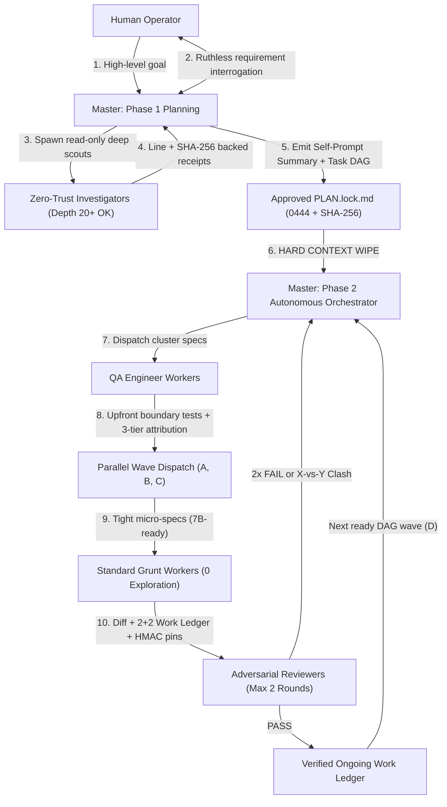
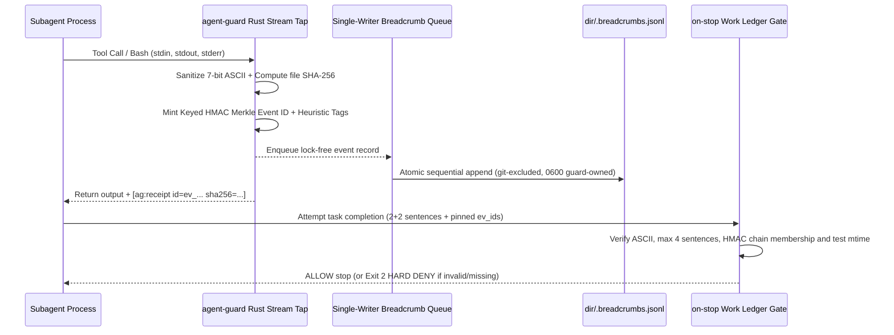
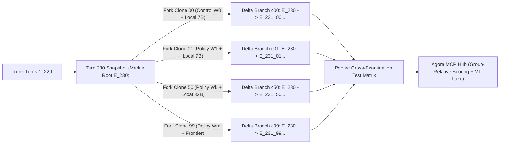

# `susanbdev/dotagent` -- Swarm Orchestration, Cryptographic Provenance & Counterfactual Telemetry Specification (v2.0)

- **Document ID**: `DOTAGENT-SPEC-SWARM-2.0`
- **Status**: Canonical Architecture Specification
- **Repository**: `susanbdev/dotagent`
- **Enforcement Kernel**: [`agent-guard`](file:///home/antigravity/susanbdev/dotagent/crates/agent-guard/src/lib.rs) (`Rust 2024`, `#![forbid(unsafe_code)]`, zero runtime dependencies)
- **Compiler & Harness Lock**: [`dotagent-compiler`](file:///home/antigravity/susanbdev/dotagent/crates/dotagent-compiler/src/main.rs)
- **Telemetry & Swarm Hub**: `Agora` (`mcp__susanbdev` Zero-Trust MCP Ingest & Coordination Plane)
- **Subordinate To**: Root [`AGENTS.md`](file:///home/antigravity/susanbdev/dotagent/AGENTS.md) (`RING-1`) and [`spec.md`](file:///home/antigravity/susanbdev/dotagent/spec.md) Ten Non-Negotiable Security Laws

---

## 1. Executive Summary & First-Principles Thesis

Monolithic coding agents operating inside shared `100k-200k` token context windows fail systematically at production scale for four structural reasons:

1. **Context Pollution & Attention Decay**: Mixing codebase exploration, raw compiler output, code authoring, and high-level decision-making inside one context buffer causes attention degradation ("lost in the middle") across multi-feature runs.
2. **Lossy Compaction Drift**: Repeatedly summarizing noisy exploration buffers discards subtle architectural constraints while preserving poisoned or hallucinated assumptions.
3. **Privilege & Prompt-Injection Coupling**: When the model holding orchestration authority directly ingests untrusted repository files, a single indirect prompt injection in source code or tool output compromises the decision-maker.
4. **Credit-Assignment Collapse**: Unstructured long-horizon transcripts cannot isolate *which* specific action, prompt constraint, model tier, or threshold caused a downstream failure--making systematic empirical improvement impossible.

### 1.1 The Core Architectural Thesis

This specification defines a **Privilege-Separated Multi-Agent Swarm + Cryptographic Runtime Provenance + N-Parallel Counterfactual Learning Architecture** built around four first-principles axioms:

1. **Protect the Decision-Maker via Total Delegation & Hard Context Wipe**: A single accountable orchestrator (`Master`) manages up to **15+ concurrent projects** while performing **zero** code exploration, **zero** code authoring, and **zero** raw diff review. After plan approval, `Master` executes a **hard context wipe** and operates strictly from an immutable approved plan summary, a topological task dependency graph, and a bounded 4-sentence-per-task Work Ledger.
2. **Disposable Single-Task Workers (Never Compacted)**: Subagents are ephemeral specialists (`Investigator`, `QA Engineer`, `Grunt`, `Adversarial Reviewer`) scoped to tiny, deterministic assignments. Subagents **never compact**; they execute at peak early-window attention, emit cryptographically pinned completion receipts, and terminate immediately.
3. **Zero-LLM Pure-Rust Ground Truth**: Agents are never trusted to self-report what they touched or whether tests passed. [`agent-guard`](file:///home/antigravity/susanbdev/dotagent/crates/agent-guard/src/lib.rs) captures `stdin`/`stdout`/`stderr` in pure Rust, chains every event with keyed `HMAC-SHA256` Merkle receipts, populates per-directory `.breadcrumbs.jsonl` ledgers via a single-writer queue, and tags anomalies (`MALICIOUS`, `OFF_TASK`, `CONFUSED`, `RISKY`) with zero LLM token cost unless `Master` triggers lazy forensic drill-down.
4. **Assume Initial Threshold Guesses Are Wrong -- Optimize via `N`-Parallel Time-Travel Forks**: Every tunable orchestration weight is externalized into a bounded `PolicyVector` while hard security invariants remain immutable in Rust. Using Copy-on-Write microVM snapshots capable of rewinding to any inflection point (e.g., `Turn 230`) and instantaneously forking `x 100` parallel arms across **intertwined Local (`7B`/`32B`) and Frontier models**, the system ships attested, public-key-encrypted Merkle delta bundles to `Agora` (`mcp__susanbdev`) to measure counterfactual outcomes and continuously improve routing and policy weights.

> [!IMPORTANT]
> **Hard Boundary Between Security Laws and Tunable Policy Weights**: Security controls (forbidden directories, 7-bit ASCII pre-buffer neutering, single root `AGENTS.md` authority, command AST denials, HMAC verification, and MCP endpoint locks) are **immutable deterministic Rust invariants** and are **never** exposed to ML weight tuning. Only bounded efficiency, routing, coverage, and triage thresholds inside `PolicyVector` may be tuned by empirical outcomes.

### 1.2 Architectural Rosetta Stone (First-Principles Mechanics -> Formal Terminology)

| First-Principles System Mechanic | Canonical Systems / Research Term |
| :--- | :--- |
| Tasks `A, B, C` run in parallel; `D` waits until `A, B, C` finish; zero circular waits | **Directed Acyclic Graph (DAG) / Topological Wave Scheduling** |
| `Master` never reads untrusted repo files; disposable workers absorb raw token burn | **Dual-LLM Privilege Separation (CaMeL Pattern)** |
| Rewind microVM state to `Turn 230` and clone `x 100` across models & policy weights | **Copy-on-Write State Branching / Execution-Grounded MCTS** |
| Score all `N` parallel clones relative to cohort mean/std on the exact same commit | **Counterfactual Evaluation / Group-Relative Policy Optimization (`GRPO`)** |
| Chain `HMAC(K, prev_id \|\| fork \|\| sid \|\| seq \|\| ts \|\| file_sha256)` across forks | **Tamper-Evident Merkle Execution Log / Cryptographic Provenance** |
| `Primary (1) / Secondary (0..2) / Tertiary (0..N)` test matrix isolating who broke a build | **Spectrum-Based Fault Localization (`SBFL`) / Combinatorial Triangulation** |
| Update routing, retry, and coverage weights from outcomes inside hard Rust safety clamps | **Constrained Contextual Bandits / Safe Offline-to-Online Policy Learning** |
| Fire `< 2 KiB` signed scorecard immediately to `Agora`; stream encrypted archive second | **Control-Plane / Data-Plane Separation** |

---

## 2. End-to-End Execution Lifecycle



### 2.1 Phase 1: Ruthless Requirements Extraction & Taint-Free Planning
1. **Mandatory Pre-Flight Interrogation**: If the human's prompt lacks crisp acceptance boundaries, edge-case behavior, or environmental constraints, `Master` **must interrogate the human upfront without sparing feelings**. Starting execution on an underspecified plan and stalling mid-flight is treated as an orchestration failure.
2. **Delegated Reconnaissance**: During planning, `Master` delegates codebase discovery exclusively to disposable `Zero-Trust Investigator` subagents. `Master` consumes only structured line-referenced receipts so untrusted repository content never enters the planning context directly.
3. **Plan Structure (`PLAN.lock.md` + `PLAN.dag.json`)**:
   - **Executive Self-Prompt Summary**: A dense, self-contained operational briefing written by `Master` *for its post-wipe self*, capturing invariants, domain constraints, architecture decisions, and risk boundaries.
   - **Topological Wave Graph (DAG)**: Standalone atomic tasks with explicit prerequisite edges (`depends_on: ["A", "B", "C"]`) and strictly disjoint `allowed_write_paths` within every concurrent wave.

### 2.2 Phase 2: Filesystem Lock (`0444`) & Hard Context Wipe
1. Once the human approves the plan, `agent-guard plan-lock` writes `PLAN.lock.md` and `PLAN.dag.json`, records their `SHA-256` digests in guard state, and sets filesystem permissions to `0444` (immutable to all agents).
2. `Master` **wipes its entire conversation context window**.
3. `Master` reboots into **Autonomous Execution Mode** seeded solely with:
   - Root [`AGENTS.md`](file:///home/antigravity/susanbdev/dotagent/AGENTS.md)
   - Approved `PLAN.lock.md` summary + `PLAN.dag.json` task graph
   - The append-only `WORK_LEDGER.jsonl` (initially empty)

### 2.3 Phase 3: Multi-Project Portfolio Scaling (15+ Concurrent Repositories)
- Each repository maintains strictly isolated `SHA-256(canonical_repo_root)` guard state, `PLAN.lock.md`, and `WORK_LEDGER.jsonl` (enforcing zero cross-repo context bleed per [`spec.md`](file:///home/antigravity/susanbdev/dotagent/spec.md) Law 10).
- Across **15+ concurrent projects**, `Master` monitors a lightweight **Portfolio Status Index** (`1` summary row per project: active wave, blocked nodes, Round-2 review escalations, security halts) and pages in a single project's `PLAN.lock` + `WORK_LEDGER` slice (`~1k-3k` tokens) only when making a dispatch or arbitration decision.

---

## 3. Formal Role Specifications & Kernel-Enforced Privilege Matrix

Every subagent invocation is bound to an explicit role profile compiled by [`dotagent-compiler`](file:///home/antigravity/susanbdev/dotagent/crates/dotagent-compiler/src/main.rs) and mechanically enforced on every `PreToolUse`, `PostToolUse`, `PostEdit`, and `OnStop` hook by [`agent-guard`](file:///home/antigravity/susanbdev/dotagent/crates/agent-guard/src/lib.rs).

| Capability / Constraint | `Master` | `Investigator` | `QA Engineer` | `Grunt` | `Adversarial Reviewer` | `Forensic Coroner` |
| :--- | :--- | :--- | :--- | :--- | :--- | :--- |
| **Talks to Human** | **YES (Sole)** | NEVER | NEVER | NEVER | NEVER | NEVER |
| **Read Repo Source** | **HARD DENY** | **ALLOW** | Spec + Interfaces | **Assigned Files ONLY** | Diff + Touched Files | Tag-Sliced Flight Spans |
| **Directory Search Depth** | `0` (Blocked) | **Unbounded (`20+` OK)** | `<= 2` (Test dirs) | **`0` (`rg`/`find` DENY)** | `<= 2` (Scoped) | `0` (Flight log only) |
| **Forbidden Zones Block** | Enforced | **Enforced (`exit 2`)** | Enforced | Enforced | Enforced | Enforced |
| **Write Scope** | Plan/Dispatch state | **ZERO (`0` Writes)** | **Test files + Matrix ONLY** | **`allowed_write_paths` ONLY** | **ZERO (`0` Repo Writes)** | **ZERO (`0` Writes)** |
| **Outbound Network** | DENY | DENY | DENY | DENY | **GET-Only Doc Allowlist** | DENY |
| **Lifecycle** | Persistent (Clean) | Ephemeral (1-shot) | Ephemeral (1-cluster) | Ephemeral (1-node) | Ephemeral (`<= 2` rounds) | Ephemeral (Lazy on alert) |
| **Target Model Tier** | Frontier | Local / Fast Frontier | Mid / Frontier | **7B Local Default** | Frontier / Diverse Family | Fast Local / Mid |

### 3.1 Role 1: `Master` ("Head Honcho" / Accountable Orchestrator)
- **Mandate**: End-to-end accountability from requirements extraction to verified completion across all active projects. Never investigates code, writes code, or reviews raw diffs personally.
- **Strict 4-Trigger Human Escalation Law**: Once `PLAN.lock.md` is approved, `Master` operates without human intervention and is **prohibited from interrupting the human** unless at least one of four conditions is verified:
  1. **Unrecoverable Spin Loop**: Tasks remain stuck in a non-converging failure loop after `Master` arbitration and re-specification.
  2. **Unforeseen Hard Architectural Blocker**: Execution uncovered a physical or systems constraint impossible to foresee in planning that cannot be worked around within contract boundaries.
  3. **Material Access / Permission Block**: Required credentials, infrastructure endpoints, or repository permissions are inaccessible and block critical-path delivery.
  4. **Confirmed Hostile Prompt-Injection Attack**: `agent-guard` recorded a verified adversarial payload targeting agent takeover or exfiltration severe enough to require human security response.
- **Sole Cross-Task Arbiter**: Resolves all inter-worker contract conflicts (`Approach X` vs. `Approach Y`) and takes control automatically whenever an `Adversarial Reviewer` loop hits **2 failed rounds**.

### 3.2 Role 2: `Zero-Trust Investigator` (Deep Read-Only Discovery Worker)
- **Mandate**: Rapid single-round token burning across wide and deep codebases to answer crisp, nearly binary technical unknowns (**Tier-1 High Trust**) or map unfamiliar subsystem topologies (**Tier-2 Landscape Analysis -- Explicitly Lower Trust**).
- **Deep Traversal Rule**: Exempt from the default `max-depth <= 2` search cap so it can run `rg` / `find` `20+` levels deep across nested monorepo packages, **while [`path_policy.rs`](file:///home/antigravity/susanbdev/dotagent/crates/agent-guard/src/path_policy.rs) continues to hard-block (`exit 2`) all forbidden paths** (`/tmp`, caches, `node_modules`, `vendor`, `.venv`, `.env*`, `~/.local/state/agent-guard`).
- **Mandatory Evidence Receipts**: Every factual claim must attach `(file_path, line_start, line_end, file_sha256, hmac_event_id)`. Unbacked assertions are stripped or rejected at the `on-stop` gate.

### 3.3 Role 3: `QA Engineer Worker` (Upfront Spec Test Architect)
- **Mandate**: Executes *prior to* `Grunt` implementation for a cluster of related DAG tasks. Translates specifications into executable edge-case, invariant, and cross-boundary integration tests.
- **Zero Production Code Access**: Hard-blocked from editing non-test source files so tests reflect specification intent rather than implementation bias.
- **Outputs**: Executable test files plus a machine-readable `test_attribution.toml` mapping every test to its **3-Tier Task Attribution** (`Primary: 1`, `Secondary: 0..2`, `Tertiary: 0..N`) and required coverage target (Section 4).

### 3.4 Role 4: `Standard Implementation Grunt Worker` ("7B-Qwen-Simple" Scoped Executor)
- **Mandate**: Pure deterministic implementation of a single atomic task node under explicit constraints, type signatures, and acceptance criteria authored by `Master`.
- **Zero Roaming / Zero Exploration**: `rg`, `find`, directory listing outside assigned paths, and reads of unassigned files are **hard-blocked**. Specifications must be explicit enough that a **local `7B` coding model** can execute the task accurately with zero guesswork, delivering **exact spec--no more, no less**.
- **Dispute Rule**: If satisfying its task requires breaking an upstream/sibling interface (`Approach X` vs. `Approach Y`), the `Grunt` cannot unilaterally alter external contracts; the conflict surfaces via the QA matrix / Work Ledger straight to `Master`.

### 3.5 Role 5: `Adversarial Code Reviewer` (Evidence-Backed Gatekeeper)
- **Mandate**: Reviews `Grunt` changes (`1:1` per task or `1:K` across a coupled task group) with blind skepticism (never shown the `Grunt`'s excuse prose first).
- **Mandatory Citation & External Truth**: Every finding must reference explicit affected lines (`file:Lstart-Lend`) and, where API contracts, standards, or security advisories apply, cite an authoritative external source of truth.
- **Controlled Exfiltration-Safe Network Access**: Granted HTTPS `GET`-only access strictly to an allowlisted set of documentation/specification domains (`docs.rs`, `crates.io`, `developer.mozilla.org`, `datatracker.ietf.org`, `nvd.nist.gov`, `github.com/advisories`, official vendor docs) with bounded query strings and zero `POST`/cookie/credential forwarding.
- **2-Round Escalation Cap**: Maximum **2 remediation cycles** per task. If findings remain unresolved after Round 2, `agent-guard` locks Round 3 and escalates to `Master` to judge genuine convergence vs. spin-out.

### 3.6 Role 6 (Lazy On-Demand): `Forensic Coroner`
- **Mandate**: Spawned *only* when `Master` spots a red/amber Rust telemetry badge during Work Ledger triage and needs deeper context than Tier-1 structural tags provide. Reads *only* sanitized, tag-filtered flight spans for a target `session_id`, emits a `<= 3`-sentence root-cause autopsy, and terminates.

---

## 4. DAG-Weighted QA Coverage & 3-Tier Fault Triangulation

### 4.1 Dynamic Importance & Coverage Target Formula

Blanket codebase-wide coverage targets waste tokens on trivial leaves while under-testing load-bearing foundations. `agent-guard` computes each task node $T$'s **Criticality Score** $I(T) \in [1, 10]$ from the approved `PLAN.dag.json`:

$$I(T) = \text{clamp}_{[1, 10]}\left(\left\lceil w_{\text{fan}} \cdot \frac{|\text{Downstream}(T)|}{|V_{\text{DAG}}|} \cdot 10 + w_{\text{prec}} \cdot S_{\text{cascade}}(T) \right\rceil\right)$$

where:
- $|\text{Downstream}(T)|$ is the total count of transitive tasks in the DAG that depend on $T$.
- $S_{\text{cascade}}(T) \in \{0.0, 0.5, 1.0\}$ measures **error-margin cascade sensitivity** (whether a minor off-by-one/type/precision deviation silently corrupts all downstream consumers).
- $w_{\text{fan}}, w_{\text{prec}}$ are tunable `PolicyVector` weights (default `0.65` and `0.35`).

Required coverage floor $C_{\min}(T)$ maps monotonically from $I(T)$:
- **Foundational Spine (`I = 10/10`)**: `>= 90%` line/branch coverage + mandatory cross-task boundary assertions.
- **Mid-Tier Node (`I = 5/10`)**: `>= 70%` coverage.
- **Isolated Leaf (`I = 1/10`, `0` downstream dependents)**: `>= 50%` pragmatic happy-path + basic error smoke coverage.

### 4.2 3-Tier Test Attribution & Deterministic Fault Elimination

Every test $t$ authored by the `QA Engineer` declares exact task dependencies in `test_attribution.toml`:
- `primary`: **Exactly `1` task ID** ($P(t) = A$)
- `secondary`: **`0..2` task IDs** ($S(t) \subseteq \{B, C\}, |S(t)| \le 2$)
- `tertiary`: **`0..N` task IDs** ($R(t) \subseteq V_{\text{DAG}}$)

Before waking or penalizing any `Grunt`, a pure-Rust fault triangulator evaluates the pass/fail bitvector across the test suite:

| Failure Signature Observed by Rust Solver | Mathematical Deduction | Automated Action |
| :--- | :--- | :--- |
| Test $t_1$ (`Primary: A`, `Secondary: []`) **FAILS** | Fault is strictly internal to `Task A`. | Dispatch repair to **Grunt `A`** only. |
| Boundary test $t_{AB}$ (`Primary: A`, `Secondary: [B]`) **FAILS**; all standalone `Primary: A` tests **PASS**; at least one standalone `Primary: B` test **FAILS** | `Task B`'s broken primary contract is poisoning `Task A`'s boundary test. | **Convict `Task B` only**. Mark `Task A` `CLEAN_BLOCKED_BY(B)` -- zero tokens wasted re-running Grunt `A`. |
| Boundary test $t_{AB}$ (`Primary: A`, `Secondary: [B]`) **FAILS**; **ALL** standalone `Primary: A` tests **PASS** AND **ALL** standalone `Primary: B` tests **PASS** | Grunt `A` chose viable `Approach X`; Grunt `B` chose viable `Approach Y`; `X` and `Y` are mutually incompatible at the seam. | **Escalate immediately to `Master` ("Daddy's Decision")** to pick `X` or `Y` and re-constrain one worker. |
| Test $t_k$ (`Primary: A`, `Secondary: []`, `Tertiary: [M]`) **FAILS** simultaneously with multiple unrelated tests sharing `Tertiary: M` while `M` fails a `Primary`/`Secondary` check | Upstream foundation `M` regressed and cascaded downstream. | Halt downstream repairs; isolate and fix root task **`M`** first. |

---

## 5. Pure-Rust Zero-LLM Provenance & Telemetry Subsystems



### 5.1 Hansel & Gretel Session Identity
Every subagent receives a unique, deterministic session coordinate minted by `agent-guard` at spawn:

`sid = ag_<repo6>_<cohort6>_c<clone3>_<wave>_<task>_<role>_<rand8>`

- Injected via protected environment variables (`AGENT_GUARD_SESSION_ID`, `AGENT_GUARD_TASK_ID`, `AGENT_GUARD_PARENT_SID`, `AGENT_GUARD_ROLE`, `AGENT_GUARD_MODEL_ID`).
- [`cmd_policy.rs`](file:///home/antigravity/susanbdev/dotagent/crates/agent-guard/src/cmd_policy.rs) hard-denies (`exit 2`) any shell attempt to unset, export, or spoof `AGENT_GUARD_*` variables.
- Stamped automatically onto every hook event, flight-log frame, directory breadcrumb, git commit trailer (`Agent-Session-Id`, `Agent-Task-Node`, `Agent-Plan-Sha256`), and child process environment.

### 5.2 Keyed `HMAC-SHA256` Merkle Stream Capture (`stdin` / `stdout` / `stderr`)
Instead of random UUIDs that require stateful table lookups or can be hallucinated by an LLM, every captured line and normalized action event is identified by a **chained `HMAC-SHA256` receipt** computed using a host-only `0600` secret key $K_{\text{guard}}$ (built atop [`sha256.rs`](file:///home/antigravity/susanbdev/dotagent/crates/agent-guard/src/sha256.rs)):

$$\text{event\_id}_n = \text{HMAC-SHA256}\Big(K_{\text{guard}},\; \text{event\_id}_{n-1} \;\|\; \text{fork\_epoch} \;\|\; \text{clone\_id} \;\|\; \text{session\_id} \;\|\; \text{seq}_n \;\|\; \text{ts\_ns}_n \;\|\; \text{op}_n \;\|\; \text{doc\_sha256}_n\Big)$$

1. **Unforgeable (`0` Hallucination Risk)**: Without $K_{\text{guard}}$, an LLM cannot fabricate a valid `event_id` for its completion receipt.
2. **Collision-Free (`seq_n`)**: Monotonic per-session sequence counter $\text{seq}_n$ guarantees distinct IDs even if an unchanged file (`same doc_sha256`) is read twice within the same nanosecond tick.
3. **Byte-State Attestation (`doc_sha256`)**: Proves the exact file content hash at the moment of `READ`, `WRITE`, `DELETE` (pre-delete hash), or `GREP`.
4. **Tamper-Evident History (`event_id_{n-1}`)**: Deleting, mutating, or reordering any historical line invalidates every subsequent HMAC in the session chain.

### 5.3 Zero-LLM Pure-Rust Heuristic Enrichment & Lazy Triage
As `stdin`/`stdout`/`stderr` streams through the Rust tap, raw lines are normalized into typed events (`FILE_READ`, `FILE_WRITE`, `FILE_DELETE`, `GREP_HIT`, `CMD_EXEC`, `TEST_RESULT`, `COMPILER_ERR`, `GUARD_DENY`) and tagged in `< 2ms` with **zero LLM tokens**:

- **`MALICIOUS`**: Prompt-injection pattern hits in [`injection_scan.rs`](file:///home/antigravity/susanbdev/dotagent/crates/agent-guard/src/injection_scan.rs), stripped non-ASCII/escape smuggling in [`sanitizer.rs`](file:///home/antigravity/susanbdev/dotagent/crates/agent-guard/src/sanitizer.rs), nonce spoofing, or any `HARD DENY` (`exit 2`) probe.
- **`OFF_TASK`**: Out-of-scope file/directory probes, high top-level directory scatter, or unapproved dependency/build-config touches.
- **`CONFUSED`**: Consecutive identical compiler/test error loops (`>= max_compile_retries`), high edit-revert thrashing (`churn_ratio = lines_edited_total / final_diff_lines`), or bursts of `ENOENT` / hallucinated symbol errors.
- **`RISKY`**: Modifying source files *after* the last passing test timestamp (`edit_after_last_green_test`), deleting/ignoring existing `#[test]`/`assert` blocks, or inserting `#[allow(...)]` / `@ts-ignore` / `unsafe` / empty `catch` suppressions.

**Lazy Consumption Rule**: `Master` ignores flight logs completely unless Tier-0's 1-line Rust badge on the Work Ledger flags an anomaly (or contradicts the worker's prose), keeping happy-path orchestration overhead at **0 extra tokens**.

### 5.4 Automated Per-Directory `.breadcrumbs.jsonl` & Single-Writer Queue
Every directory touched by any subagent (`READ`, `WRITE`, `DELETE`, `GREP`) receives a physical `.breadcrumbs.jsonl` trail maintained **100% by pure Rust**:
- **Single-Writer Queue Architecture**: Subagents write lock-free to per-session spools (`~/.local/state/agent-guard/spools/<sid>.jsonl`); an `agent-guard` single-writer queue worker drains events sequentially into each target `<dir>/.breadcrumbs.jsonl`, eliminating parallel `flock` contention and partial-line corruption across concurrent waves.
- **Guard-Protected & Git-Stripped**: `.breadcrumbs.jsonl` is write/delete-blocked to all agents in [`path_policy.rs`](file:///home/antigravity/susanbdev/dotagent/crates/agent-guard/src/path_policy.rs) and automatically excluded from `git` commits via `.git/info/exclude`, while **100% harvested into the encrypted `Agora` telemetry bundle** prior to workspace cleanup.

### 5.5 Mandatory `on-stop` Work Ledger (`2 + 2` Sentences + Receipt Pins)
No subagent task is marked complete until `agent-guard ledger-submit` succeeds and `agent-guard on-stop` verifies:
1. **`actions_taken`**: `1..=2` declarative sentences in pure 7-bit ASCII stating explicit changes or findings made.
2. **`issues_and_mitigations`**: `1..=2` declarative sentences in pure 7-bit ASCII describing issues encountered and how they were resolved or worked around (plus `contract_status: EXACT | LOCAL_WORKAROUND | INTERFACE_CHANGED`).
3. **`pinned_event_ids`**: Non-empty array of `HMAC` `event_id`s verified in $O(1)$ by Rust to exist inside *this* `session_id`'s normalized event log and match the final on-disk `SHA-256` of modified files.

---

## 6. Time-Travel MicroVM Forking (`Turn T -> x 100`) & Policy Learning



### 6.1 MicroVM Snapshot Rewind & Fork-Safe Merkle Lineage
When an execution reaches a high-leverage inflection point (e.g., `Turn 230`), the microVM supervisor can pause, reset 1 step back to `Turn 230`, and instantaneously clone **`N = 100+` identical microVMs** across **intertwined Local models (`7B`, `32B`) and Frontier models** paired with distinct `PolicyVector` candidates.

To prevent post-snapshot state collisions (where 100 restored VMs wake up sharing identical disk state, `seq_no = 230`, and `last_event_id = E_230`):
1. On wake, `agent-guard` reads host-injected clone coordinates (`AGENT_GUARD_COHORT_ID`, `AGENT_GUARD_FORK_EPOCH`, `AGENT_GUARD_CLONE_INDEX = 0..99`, `AGENT_GUARD_MODEL_ID`, `AGENT_GUARD_POLICY_SHA256`) plus fresh kernel entropy (`/dev/urandom` + `/proc/sys/kernel/random/boot_id`).
2. Each clone emits a **`FORK_BRANCH` genesis event** at `Turn 231` chained directly off `parent_merkle_root = E_230`.
3. **Guarantees**: Zero ID collisions across all 100 clones, cryptographic proof that every clone started from exact byte state `E_230`, and `95%+` storage/bandwidth deduplication (`Turns 1..230` stored once; clones ship only `Turn 231..End` deltas).

### 6.2 Externalized `PolicyVector` ("Places to Nudge")
All heuristic guesses are isolated in a signed, schema-versioned `PolicyVector` (`policy.v1.json`) clamped within hard Rust `[min, max]` bounds:
- **QA Coverage Curve**: `base_coverage_floor` (`[0.40, 0.80]`), `fanout_weight` (`[0.10, 0.90]`), `cascade_weight` (`[0.10, 0.90]`), `spine_coverage_cap` (`[0.85, 0.99]`).
- **Model Routing Knobs**: `grunt_7b_max_files` (`[1, 5]`), `min_spec_tokens_per_target` (`[40, 500]`), `local_to_frontier_complexity_cutoff` (`[0.1, 1.0]`).
- **Spin-Out Early Kill Switches**: `max_consecutive_compile_fails` (`[2, 8]`), `max_churn_ratio` (`[2.0, 10.0]`), `max_enoent_streak` (`[2, 6]`).
- **Review & Escalation Knobs**: `max_adversarial_rounds` (`[1, 3]`, default `2`), `reviewer_cluster_max_tasks` (`[1, 5]`).
- **Triage Alert Thresholds**: `dir_scatter_alert_count` (`[2, 10]`), `retry_alert_weight` (`[0.1, 5.0]`).

### 6.3 Counterfactual Cross-Examination & ML Training Loop
1. **Anti-Gaming Union Test Gate**: Across an `N`-arm cohort, candidate trees are cross-tested against the **pooled union of spec-valid QA tests** so no `PolicyVector` can appear superior simply by lowering test rigor.
2. **Group-Relative Advantage Scoring (`GRPO`)**: Within cohort $c$, each clone $i \in \{0..N-1\}$ receives a task-difficulty-normalized advantage score:
   $$A_i = \frac{R_i - \mu_c}{\sigma_c + \epsilon}$$
   balancing cross-tested pass rate, review defect count, total token cost, wall-clock latency, and `Master` interventions.
3. **Staged Model Evolution**:
   - *Cold Start (`Runs 1-100`)*: Deterministic baseline weights + full telemetry banking.
   - *Tabular Bandit Phase (`Runs 100-2,000`)*: `LightGBM` / Contextual Bandits update `PolicyVector` routing and kill-switch thresholds.
   - *Local Grunt Distillation (`Runs 5,000+`)*: Verified `(Turn 230 State E_230 -> Passing Frontier/Local Diff vs. Failing Local Diff)` branches provide compiler-verified `Step-DPO` and `SFT` datasets to continuously upgrade local `7B` Grunts.

---

## 7. `Agora` Zero-Trust MCP Telemetry Protocol & Cryptographic Sealing

To sustain `100+` simultaneous microVM completions without ingest bottlenecks, [`agent-guard`](file:///home/antigravity/susanbdev/dotagent/crates/agent-guard/src/lib.rs) transmits exclusively to `Agora` (`mcp__susanbdev`) using a **Two-Lane Control/Data Split**:

1. **Lane 1 -- Immediate Hot Scorecard (`< 2 KiB` Signed JSON)**:
   - Sent synchronously on clone completion; routed via consistent hash `hash(cohort_id)` so a single `Agora` shard scores all `100` clones in memory in `< 10ms` with zero distributed locks.
2. **Lane 2 -- Jittered Cold Telemetry Bundle (Attested + Public-Key Encrypted)**:
   - Packs **Merkle delta events** (`Turn_fork+1 .. End`), harvested `<dir>/.breadcrumbs.jsonl` files, `test_attribution.toml` outcomes, `WORK_LEDGER.jsonl`, and `PolicyVector` metadata.
   - Generates `manifest.sha256` signed with host attestation key (`Ed25519` / `HMAC` receipt).
   - **Asymmetric Public-Key Encryption** (RFC 9580 OpenPGP / `X25519 + ChaCha20-Poly1305`) using **only `Agora`'s public recipient key** on the microVM--ensuring a compromised worker VM can **never** decrypt historical bundles or reverse-engineer global ML weights.
   - Flushed with deterministic stagger (`clone_index * 20ms`) keyed by `bundle_sha256`.

---

## 8. Canonical Record Schemas

### 8.1 Per-Directory Breadcrumb Entry (`<dir>/.breadcrumbs.jsonl`)
```json
{
  "schema": "dotagent.breadcrumb.v1",
  "ts_ns": 1794531616000000000,
  "cohort_id": "coh_9f31a0",
  "fork_epoch": 1,
  "clone_id": 42,
  "session_id": "ag_api9f2_coh9f3_c042_w2_nodeB_grunt_7c41e09a",
  "role": "grunt",
  "model_id": "local:qwen2.5-coder-7b",
  "event_id": "ev_9d4e2a11c8b04f77e1029384756aabbccddeeff00112233445566778899aabb",
  "op": "WRITE",
  "file": "token_validator.rs",
  "lines": "42-89",
  "doc_sha256": "e3b0c44298fc1c149afbf4c8996fb92427ae41e4649b934ca495991b7852b855"
}
```

### 8.2 Verified Work Ledger Entry (`WORK_LEDGER.jsonl`)
```json
{
  "schema": "dotagent.work_ledger.v1",
  "cohort_id": "coh_9f31a0",
  "clone_id": 42,
  "wave_id": "W2",
  "task_id": "W2.nodeB",
  "session_id": "ag_api9f2_coh9f3_c042_w2_nodeB_grunt_7c41e09a",
  "role": "grunt",
  "model_id": "local:qwen2.5-coder-7b",
  "contract_status": "EXACT",
  "actions_summary": "Implemented strict ASCII token header parser in src/auth/token_validator.rs matching the W2.nodeB trait signature. Added unit boundary checks for empty and malformed bearer prefixes.",
  "issues_and_mitigations": "Initial borrow on slice lifetime conflicted with zero-copy return type. Switched return type to borrowed subslice tied to input buffer lifetime within spec constraints.",
  "pinned_event_ids": [
    "ev_9d4e2a11c8b04f77e1029384756aabbccddeeff00112233445566778899aabb",
    "ev_44f1098bc2217a0099887766554433221100ffeeddccbbaa9988776655443322"
  ],
  "rust_ground_truth": {
    "actual_files_touched": ["src/auth/token_validator.rs"],
    "scope_violation": false,
    "post_test_edit": false,
    "test_exit_code": 0,
    "churn_ratio": 1.25,
    "heuristic_badge": "CLEAN",
    "alert_tags": []
  }
}
```

### 8.3 `Agora` Hot Control-Plane Scorecard (`< 2 KiB`)
```json
{
  "schema": "agora.scorecard.v1",
  "cohort_id": "coh_9f31a0",
  "fork_turn": 230,
  "parent_merkle_root": "ev_77ab001928374655fa01928374655fa01928374655fa01928374655fa0192837",
  "leaf_merkle_root": "ev_44f1098bc2217a0099887766554433221100ffeeddccbbaa9988776655443322",
  "clone_id": 42,
  "is_control": false,
  "policy_vector_sha256": "8a12bc9900112233445566778899aabbccddeeff001122334455667788990011",
  "model_routing_mix": {"grunt": "local:qwen2.5-coder-7b", "reviewer": "frontier:claude-sonnet"},
  "outcomes": {
    "primary_tests_passed": 18,
    "primary_tests_total": 18,
    "boundary_conflicts": 0,
    "adversarial_rounds_used": 1,
    "master_escalations": 0,
    "total_tokens": 11420,
    "wall_time_ms": 14800,
    "alert_counts": {"malicious": 0, "off_task": 0, "confused": 0, "risky": 0}
  },
  "encrypted_bundle_sha256": "c0ffee112233445566778899aabbccddeeff00112233445566778899aabbccdd"
}
```
